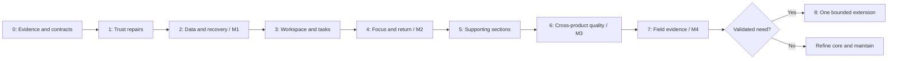

# Flowtask major upgrade plan

**Version:** 1.0 · **Prepared:** 26 October 2026  
**Status:** Proposed; implementation has not started  
**Quality target:** 10/10 in every assessed dimension, earned through verification and sustained user evidence  
**Scope:** A phased product and engineering upgrade, preserving the current stack and existing user data

## 1. Direction and basis

Build Flowtask around one dependable loop:

**Capture → choose realistic work → start with context → handle interruption → resume → close with a useful next action.**

Every section should make that loop easier. A section can reach excellent quality through a small, coherent scope; it does not need every feature from a specialist competitor. Goals, routines, study tools and custom dashboards remain optional capabilities rather than prerequisites for using the product.

This plan develops the latest [product audit](C:/Users/kunal/Desktop/Flow-task/docs/research/2026-10-26-strategy/REPORT.md), [33-product competitive analysis](C:/Users/kunal/Desktop/Flow-task/docs/research/2026-10-26-strategy/COMPETITIVE_INTELLIGENCE.md) and [verification record](C:/Users/kunal/Desktop/Flow-task/docs/research/2026-10-26-strategy/evidence/VERIFICATION.md) into executable phases. Those documents contain the current evidence and reproduction steps.

The audit's **5.4/10** is the working baseline. Older documents, including the historical master plan, contain “complete” and “10/10” claims that are not accepted as proof of current quality. No phase, screen or score becomes complete merely because its code exists or its tests pass.

**10/10 is the target, not a promised outcome.** Achieving it requires correctness, interaction quality, accessibility, recovery, performance and demonstrated preference from the intended users. This document defines the evidence needed to make that judgment. It does not assign future scores in advance.

### Product boundaries

- **Initial audience hypothesis:** interruption-prone independent builders doing one to three self-directed projects on a laptop. Validate students as a separate acquisition segment rather than designing two different defaults at once.
- **Core promise:** return to meaningful work with a clear next action, useful context and a trustworthy plan.
- **Keep:** React/TypeScript, workspace store, IndexedDB, optional Firebase, command/undo infrastructure, shared focus lifecycle, notes, existing recovery and validation foundations.
- **Consolidate:** scheduling rules, capture semantics, daily home, timer vocabulary, contextual notes and review entry points.
- **Avoid for this program:** a framework rewrite, full PKM platform, team PM suite, proprietary video coworking network, automatic browser-history collection, medical/biometric optimization and speculative autonomous agents.
- **Implementation boundary:** this is a plan. Source changes, schema migrations, screen redesign implementation, installs and deployment require subsequent implementation authorization.

## 2. What 10/10 means

### Master quality scorecard

The historical scores below retain the audit's judgment scale. The final column is a qualification standard, not a forecast. Final reassessment must cite the release, test environment, limitations and user cohort.

| Dimension | Audit baseline | Target | Evidence required for the target |
|---|---:|---:|---|
| Workflow coherence | 5.0 | 10 | One task and one execution lifecycle across capture, plan, Studio, notes and review; unfamiliar users navigate the complete loop without explanation; invested users retain their data and workflows. |
| Capture and task management | 6.5 | 10 | Predictable dates, fast accurate capture, accessible task editing, reliable dependencies/undo and no duplicate work created by retries. |
| Planning trust | 3.5 | 10 | Universal lock/conflict enforcement; coherent time model; truthful effort/occupancy/free-time labels; correct timezone and migration behavior; inspectable reversible replanning. |
| Focus and execution | 7.0 | 10 | Immediate Start/Resume, useful context, clear pause/park/finish semantics, durable recovery and no duplicate logs across supported lifecycle cases. |
| Visual and interaction quality | 6.0 | 10 | A consistent hierarchy and interaction system across all states; atmosphere never compromises readability, speed or user control; target users find the experience clear and satisfying. |
| Mobile and accessibility | 5.0 | 10 | Core journeys work on real supported phones, keyboard and assistive technology; relevant WCAG 2.2 AA criteria reviewed; no blocked workflows or hidden controls. |
| Engineering and recovery | 7.0 | 10 | Supported-runtime CI, transactional behavior, verified restore/migration/conflicts, measured performance budgets, least-privilege integrations and maintainable domain boundaries. |
| Differentiation and repeat value | 4.0 | 10 | Target users repeatedly prefer Flowtask for the chosen job over their current tool combination; reduced reconstruction burden, voluntary return, manageable support and credible willingness to pay. |

### Scoring and completion rules

1. **Correctness before polish.** A section with a known data-loss, silent scheduling or inaccessible core-action defect cannot receive an excellent score.
2. **No compensating averages.** A beautiful Studio cannot cancel out broken scheduling. Every dimension must qualify independently.
3. **8/10 candidate:** required behavior and recovery tests pass, supported-device journeys work, and formative usability reveals no blocking issues.
4. **9/10 candidate:** users complete the workflow reliably in the beta, measured speed/clarity goals hold, and major friction has been addressed.
5. **10/10 candidate:** sustained use supports the section's intended outcome, critical reliability holds through the declared observation period, and a fresh review finds no material gap for the declared scope. Ratings remain revisable as evidence changes.
6. **Unknown stays unknown.** Insufficient user evidence, untested browsers or unverified restore paths are reported explicitly; they are not scored as successes.

All numeric usability, retention and latency targets in this plan are **proposed internal acceptance criteria**, not established Flowtask results or universal industry benchmarks. Freeze the first evaluation criteria in Phase 0; change them only with a recorded reason, not to make a release pass.

## 3. Program structure and effort

Assume one engineer familiar with the repository, part-time product/design help and a small recruited research cohort. Engineering-day ranges include relevant tests and documentation. Phase 6 covers cross-product verification and optimization beyond the work required within earlier phases.

| Phase | Purpose | Engineering days | Dependency | Release result |
|---|---|---:|---|---|
| **0 — Baseline and contracts** | Freeze evidence, user jobs, behavior contracts and measurement. | 4–6 | None | Reviewed execution specification. |
| **1 — Immediate trust repairs** | Stop known scheduling/capture/assistance failures. | 10–15 | Phase 0 | Narrow trust-fix candidate. |
| **2 — Canonical data and recovery** | Unify reservations and protect persistence, migration and sync. | 18–26 | Phase 1 policy | **M1: trustworthy planning foundation.** |
| **3 — Workspace and task flow** | Simplify Today, navigation, capture, task editing, projects and context access. | 15–22 | M1; Phase 0 design direction | Integrated workspace candidate. |
| **4 — Focus and return continuity** | Make Start/Resume and interrupted-work recovery exceptional. | 12–18 | Phase 3 task/context flow; Phase 2 durability | **M2: focused product beta.** |
| **5 — Supporting sections** | Align study, reviews, goals, routines, settings and extension with the core. | 15–24 | Shared contracts and M2 | Complete bounded section coverage. |
| **6 — Quality and release hardening** | Cross-device accessibility, visual consistency, performance, security and failure handling. | 14–22 | Earlier phase acceptance; checks start earlier | **M3: release candidate.** |
| **7 — Field validation and reassessment** | Observe four-week return, compare incumbents, resolve highest-impact friction. | 5–8 plus observation | Stable M2/M3 cohort build | **M4: evidence-backed launch decision and scorecard.** |
| **8 — Conditional extensions** | Add only validated integration/assistance improvements. | Separately estimated | M4 and explicit demand/cost gate | Optional follow-up program. |

**Base effort, Phases 0–7: 93–141 engineering days.** Reserve approximately 20% for integration discoveries and research-driven revisions: **112–169 days total**, or roughly 22–34 full engineering weeks. Allow approximately **24–38 calendar weeks** when observation and availability are included. This is broader than the audit's focused 14–20-week core program because it explicitly covers all supporting sections and final quality work. Phase 8 is excluded from these totals.

Release useful slices earlier: the trust repairs do not wait for all sections. Do not promise a universal 10/10 transformation in a few sprints. Re-estimate after Phase 0 and after migration characterization in Phase 2.

Accessibility, persistence correctness and privacy apply in every phase. Phase 6 is their final integrated gate, not permission to postpone them.

## 4. Coverage across all product sections

Every row has a bounded 10/10 target. Secondary tools are judged on useful integration and optionality, not on matching an entire specialist market.

| ID | Section | Required end state | Main phases |
|---|---|---|---|
| S01 | Landing and onboarding | The promise matches delivered behavior; a user begins useful work without setup or account pressure. | 0, 3, 7 |
| S02 | Workspace, Today and dashboards | One authoritative daily home; capture and Resume are immediately available; customization remains safe and optional. | 3, 6 |
| S03 | Capture, Inbox, Upcoming, Someday | One predictable capture contract with explicit context defaults and correct date meaning. | 1, 3 |
| S04 | Task detail, subtasks and dependencies | Fast simple editing with advanced power on demand; consistent availability and safe bulk/undo behavior. | 1, 2, 3 |
| S05 | Projects and views | Outcomes and next available work are clear; list/board/matrix express the same task state. | 3, 6 |
| S06 | Calendar, Plan and capacity | One reservation truth, protected commitments, honest quantities and reversible repair. | 1, 2, 6 |
| S07 | Focus Studio, timer and audio | One dependable lifecycle with a quiet active state and useful return context. | 2, 4, 6 |
| S08 | Notes and execution context | Relevant note/selection/link reachable from work; no second PKM setup required. | 3, 4 |
| S09 | Study Hub and sessions | Optional study specialization; ordinary scheduled work remains general work. | 1, 2, 5 |
| S10 | Reviews, logbook and insights | Accurate actuals and an actionable reflection; no productivity theater or guilt scoring. | 4, 5, 7 |
| S11 | Life areas and goals | Optional connection to work with clear progress meaning and preserved data. | 3, 5 |
| S12 | Routines | Small repeatable actions with understandable completion, skipping and history. | 5 |
| S13 | Search and keyboard interaction | Find tasks/context quickly and complete core work without a pointer. | 3, 6 |
| S14 | Reminders and notification behavior | Conditions, permissions, quiet periods and delivery limitations are clear and tested. | 2, 5, 6 |
| S15 | Appearance and interaction system | Coherent visual hierarchy, readable surfaces, consistent states and restrained motion. | 0, 3, 4, 6 |
| S16 | Mobile and accessibility | Core actions remain available with touch, zoom, keyboard and assistive technology. | All; final gate 6 |
| S17 | Local data, backup, recovery and cloud sync | Honest durability status, proven restore, recoverable migration and inspectable conflicts. | 1, 2, 6 |
| S18 | Settings, account and privacy | Discoverable settings, accurate storage/sync scope, safe account transitions and export access. | 2, 5, 6 |
| S19 | Browser extension and interoperability | Deliberate page capture with correct provenance and durable acknowledgement; no hidden collection. | 3, 5, 8 |
| S20 | Architecture, performance, security and QA | Shared policies, bounded complexity, measured budgets, maintained tests and operational readiness. | All |

## 5. Shared product contracts

Resolve these once. Individual views may have different presentation and intentional defaults, but cannot redefine the underlying behavior.

### 5.1 Task and date meaning

| Concept | Contract |
|---|---|
| Planned day | Day the user intends to work; does not imply a deadline or time reservation. |
| Deadline | A real completion constraint; distinct from planned day. Date-only deadlines remain date-only unless the user specifies a time. |
| Defer / Someday | Controls availability without inventing urgency. Deferred work is not selected by automation before it becomes eligible. |
| Effort estimate | Expected work, with explicit provenance: user estimate, assumption or suggestion. Unknown is a valid state. |
| Remaining effort | User-maintained or explicitly agreed calculation; focus time is not automatically treated as equivalent completed effort. |
| Reservation | A WorkBlock interval attached to a task, independent from actual work. |
| Focus log | Actual recorded session and outcome; never sufficient by itself to mark a task complete. |
| Work kind | Optional study/general classification; independent from whether a task is scheduled or timed. |

**Proposed capture examples, using 26 October 2026 as reference:**

| Input and surface | Expected interpretation |
|---|---|
| `Read chapter tomorrow ~45m` from Today | Planned 27 October; estimate 45m; no deadline and no clock reservation. |
| `Send proposal due Friday` | Deadline 30 October; planning date determined only by explicit input or clearly disclosed surface default. |
| `Send proposal plan:tomorrow due:Friday` | Planned 27 October; deadline 30 October. |
| `Buy paper` from Inbox/global capture | Inbox; no planned day unless the selected capture destination says otherwise. |
| `Buy paper` from Today | Planned today; preview/context makes that default clear. |
| Unsupported/ambiguous date phrase | Retain editable title and visible uncertainty; never silently strip text or fabricate a precise date. |

Validate ordinary-language meaning in Phase 0. Support existing explicit syntax and document the change. Historical deadlines must not be silently converted into planned days.

### 5.2 Scheduling rules

- One shared command policy covers create, move, resize, preset, nudge, date change, bulk change, unschedule and preview apply.
- Locked time cannot change until explicitly unlocked. Generic task patches cannot bypass the policy. Any administrative repair path is separately audited and not used as a UI shortcut.
- Conflicts are rejected or explicitly acknowledged before commit. Acknowledged overlaps stay visible; confirmation must not become a silent global preference.
- A preview describes changes, affected commitments and unresolved conflicts. It includes a revision/fingerprint so stale previews cannot overwrite newer work.
- Related changes commit atomically and undo together. Retrying an operation cannot create duplicate blocks.
- External busy time has source/freshness status. Missing or stale calendar data is not presented as guaranteed availability.
- A planned-day change does not silently move locked reservations. Ask the user to reconcile the specific relationship or leave the reservation unchanged.
- Completing/canceling a task follows an explicit future-reservation rule: retain recoverable cancellation/history rather than silently rewriting past work; undo restores the agreed state.
- Unsupported scheduling cases fail clearly and preserve the original task.

### 5.3 Time presentation

Present separate facts rather than one overloaded capacity bar:

1. **Effort:** estimated remaining work for the selected eligible tasks; show unknown/assumed portions.
2. **Effort budget:** the user's chosen task-effort allowance. Its unused portion is estimate headroom, not necessarily a free calendar slot.
3. **Reservation demand:** sum of reservation durations in the relevant window.
4. **Occupied time:** union of those intervals; overlapping reservations are not counted twice.
5. **Free time:** working-window intervals minus the union of external busy events and reservations; for remaining-today views, exclude elapsed time.
6. **Conflicts:** intersecting commitments, including their source and whether acknowledged.

**Acceptance example:** before an 08:00–18:00 work window with no meetings, two 180-minute reservations at 08:00–11:00 and 14:30–17:30 reserve 360 unique minutes and leave 240 free. Their tasks may still total only 75 estimated minutes. If both reservations move to 14:30–17:30, demand stays 360, unique task occupancy is 180 and overlap excess is 180. Neither case should display “285 minutes of breathing room” as calendar availability.

Use simple primary wording and progressive detail; these definitions do not require six permanent dashboard widgets. Distinguish full-day versus remaining-day views and clip intervals consistently at window boundaries.

### 5.4 Execution semantics

| Action | Task effect | Session effect | Context effect |
|---|---|---|---|
| Start | Task remains unfinished. | Creates one active session after eligibility check. | Shows current next action and relevant context. |
| Pause | No completion or replanning. | Stops counting active work; resumable. | No mandatory form. |
| Resume | Same task, unless user explicitly switches. | Resumes compatible session; never duplicates active timers. | Restores cue and context. |
| Park | Task remains unfinished. | Ends the session as interrupted with actual recorded time. | Optional concise return cue; clearly different from Pause. |
| Finish session | Does not automatically complete task. | Ends/logs session once. | Optional outcome and next action. |
| Complete task | Explicit task completion. | If active, reconciles session once. | Retains links/history; applies documented future-block rule. |
| Break | No implied completion. | Distinct break state if used. | Does not launch another work round without a clear choice. |

When the app is suspended or closed, a wall-clock gap is not proof the user worked. Choose and document recovery behavior in Phase 2: show an interrupted/recovered state, preserve known elapsed work and let the user confirm or correct uncertain gaps. Do not silently claim closed-app alarms or continuous work.

## 6. Phase 0 — Baseline, contracts and product specification

**Objective:** make implementation decisions concrete before altering interconnected behavior.  
**Effort:** 4–6 engineering days. **Owner:** engineering lead with product/design input.

### Work

- [ ] **0.1 Record the implementation baseline.** Save current revision, working-tree status and relevant file hashes; distinguish pre-existing changes. Reproduce audit F01–F06 against that baseline before assuming they remain unchanged.
- [ ] **0.2 Freeze the critical journey set.** Fresh user, returning unfinished work, changed day, offline capture, locked reservation, note-linked task and existing power-user workspace.
- [ ] **0.3 Inventory schedule readers/writers.** Include drawer, composer, both calendar presentations, Today rail, auto-slot, preview apply, nudge, unschedule, date changes, recurring/study paths and extension capture where relevant.
- [ ] **0.4 Agree the contracts in Section 5.** Include all-day/date-only behavior, midnight/DST, unknown estimates, focus recovery, task completion and undo.
- [ ] **0.5 Specify the navigation and screen hierarchy.** Produce reviewable wireframes/state descriptions for Today, drawer, Plan and Studio entry. Use current components where possible; no decorative redesign exercise.
- [ ] **0.6 Recruit and interview.** Begin 8–12 problem interviews; observe current tool combinations and interruption/reconstruction examples. Start with five formative sessions if recruitment is slow, and mark remaining evidence pending.
- [ ] **0.7 Freeze reference environments and budgets.** Supported browsers/runtime, physical phone targets, realistic data fixtures, timing methodology, accessibility checklist and cohort definitions.
- [ ] **0.8 Rank the release backlog.** Confirm the highest-risk assumptions and revise effort using the code inventory. Record every excluded capability.

### Outputs and exit gate G0

Produce a behavior-spec checklist, reader/writer inventory, migration-shape inventory, screen/state specification, measurement sheet and issue list tied to the audit. G0 passes when conflicting behaviors have explicit decisions and each known failure has a regression scenario. Recruitment may continue, but user assumptions must remain labeled.

**Scope guard:** no stack replacement or blanket directory reorganization. Decompose only where a behavior change or measured performance problem warrants it.

## 7. Phase 1 — Immediate trust repairs

**Objective:** stop the known ways Flowtask makes the wrong promise.  
**Effort:** 10–15 days. **Dependencies:** G0. **Priority:** release-blocking core fixes.

### Work

- [ ] **1.1 Enforce one schedule policy on current data.** Wrap all identified mutation paths with shared lock, eligibility, interval and conflict checks. Fix the drawer bypass immediately; do not wait for the full canonical migration.
- [ ] **1.2 Add atomic rejection and undo.** A failed edit must not partially change date, session metadata or clock values. Surface actionable reasons and restore focus to the initiating control.
- [ ] **1.3 Correct capture-date behavior.** Implement the validated bare-date/explicit-deadline contract, editable preview and intentional surface defaults. Preserve unrecognized text and existing explicit syntax.
- [ ] **1.4 Correct time labels using available data.** Separate estimated effort from reservations; remove false breathing-room wording; make assumed/default 30-minute values visibly assumed. Do not rewrite estimates as a shortcut to make bars agree.
- [ ] **1.5 Correct session defaults.** Use an explicit task duration/remaining estimate when available; otherwise offer a small, disclosed default or duration choice. Three-hour presets must not be silently applied to ordinary short tasks.
- [ ] **1.6 Fix breakdown credibility.** Remove ambiguous audit→tax matching, label local templates honestly, offer one editable first action or explicit uncertainty, and avoid unsupported exact durations.
- [ ] **1.7 Stop new study misclassification.** Separate new general reservations from study intent through a compatible transitional representation; existing ambiguous records are resolved in Phase 2.
- [ ] **1.8 Add targeted regressions.** Cover every failed path and shared command boundary, rather than only the repaired UI control.

### Acceptance gate G1

- Locked tasks cannot be moved by presets, dragging, resizing, nudging, date edits or preview/bulk apply.
- Drawer overlaps require the same visible choice as other supported scheduling paths.
- The audit's date, 75-minute/six-hour, unrelated-breakdown and study-classification examples produce the agreed behavior.
- No failed operation loses context or creates a duplicate reservation; undo restores the original state.
- Existing local tests, supported-runtime type/lint checks and relevant browser regressions pass; introduced warnings are resolved.

**Release:** a narrow trust-fix candidate can ship after its own recovery checks. It must not be marketed as completion of the major upgrade.

## 8. Phase 2 — Canonical scheduling, durability and recovery

**Objective:** eliminate independent time truths while protecting existing work.  
**Effort:** 18–26 days. **Dependencies:** G1 shared policy. **Milestone:** M1.

### Work

- [ ] **2.1 Define the canonical reservation shape.** Reuse WorkBlock/service foundations; reservation identity, task reference, interval, timezone, lock, source and revision have one authoritative representation.
- [ ] **2.2 Build a read adapter before switching writers.** Handle global WorkBlocks, embedded blocks and legacy task clocks without displaying duplicates. Establish documented source precedence and flag contradictions.
- [ ] **2.3 Complete the command boundary.** All create/move/resize/unschedule/replan/completion operations use the same domain commands. UI-specific allow flags cannot silently bypass safeguards.
- [ ] **2.4 Define timezone policy.** Keep calendar dates separate from instants, distinguish all-day events, preserve intended local reservation time where known and test timezone changes, DST gaps/folds and cross-midnight intervals.
- [ ] **2.5 Implement conservative migration.** Snapshot first, classify records, convert unambiguous cases idempotently and preserve ambiguous/conflicting originals for user review. Do not guess missing timezone offsets.
- [ ] **2.6 Resolve study classification.** Preserve explicit study tags/intent. Ambiguous scheduled sessions receive a reviewable compatible state rather than bulk conversion into study or silent loss from users' workflows.
- [ ] **2.7 Coordinate storage, backup and cloud schemas.** Version each contract intentionally, update validators/rules first, establish old-client compatibility and unsupported-version messaging, and preserve offline outbox safety.
- [ ] **2.8 Verify durable acknowledgement.** Optimistic display and local durable save are distinct states; delayed/failing persistence cannot be described as saved. Retry is idempotent and failure offers recovery/export.
- [ ] **2.9 Exercise restore.** Export → reset a disposable test workspace → import/restore → compare tasks, notes, links, blocks, focus logs, settings and relationships. Test interrupted/malformed imports without replacing valid data.
- [ ] **2.10 Verify ownership and account boundaries.** Test two tabs, owner loss, unsupported locking environments, sign-in/out, local-to-account transition and concurrent edits on two signed-in test devices. Preserve conflict copies and prevent cross-account data leakage.
- [ ] **2.11 Specify focus recovery checkpoints.** Verify reload, sleep, clock changes and uncertain closed/suspended gaps; no duplicate logs or silent hours of credited focus.
- [ ] **2.12 Retire legacy writers only after parity.** Keep compatibility projections/adapters for an explicit support window; no indefinite dual-authority model.

### Migration release order

1. Fixtures and snapshots.
2. Compatible validators/cloud rules and read adapter.
3. Guarded canonical writes for new records.
4. Dry-run conversion summaries and ambiguous-case review.
5. Opt-in conversion with restore verification.
6. Small beta rollout and support inspection.
7. Default conversion only after G2; remove old writers later.

Schema rollback is not simply deploying an older client. If canonical data has been written, keep a reader that understands it; disable new writes, preserve a snapshot, and repair/restore through a compatible path. Test that recovery sequence before enabling conversion.

### Acceptance gate G2 / M1

- The same schedule appears in Today, Plan, drawer, Study Hub when applicable, backup and cloud round-trip.
- Adversarial migration fixtures preserve records and relationships, flag ambiguity and avoid duplicates on repeated runs.
- Scheduling mutations are atomic, revision-aware, idempotent and undoable.
- Restore, interrupted write, owner-tab loss and cloud conflict drills succeed in declared environments.
- No known unresolved critical loss/ownership/security issue remains.
- The old-client support boundary and recovery runbook are documented.

## 9. Phase 3 — Workspace, capture and task experience

**Objective:** make the correct next action easy to see and act on.  
**Effort:** 15–22 days. **Dependencies:** M1; Phase 0 hierarchy specification.

### Work

- [ ] **3.1 Establish one default Today.** Capture, the active/return task and a small chosen list form the primary hierarchy. Schedule information appears only at useful density. Avoid default empty life/study widgets.
- [ ] **3.2 Simplify navigation.** Primary destinations: Today, Inbox, Plan, Projects and Notes; Focus is a global action/active state. Review and optional Study/Life/Goals/Routines remain discoverable in secondary navigation. Preserve deep links and user choices.
- [ ] **3.3 Preserve advanced dashboards.** Existing custom layouts/data remain usable; expose them through explicit customization, retain a safe default/reset and prevent edits from accidentally changing underlying task state.
- [ ] **3.4 Unify capture surfaces.** Shared parsing/commands with explicit destination defaults, editable metadata, IME/paste support, retry safety and correct feedback about where the task went.
- [ ] **3.5 Introduce progressive task detail.** Primary: title, next action, context, project, planned day and estimate. Scheduling/deadline appear clearly when relevant. Dependencies, recurrence, goal links and specialized properties are secondary. Retain access to all stored values.
- [ ] **3.6 Standardize rows and actions.** One completion state, scheduling vocabulary and action menu across list/board/matrix/Top 3. Use color as support rather than the only signal. Prevent nested interactive controls from stealing keyboard/pointer actions.
- [ ] **3.7 Make project next work explicit.** Outcome and available action first; sequential order is explicit and user-controlled if enabled. Blocked work explains why. Archived projects do not leak into planning.
- [ ] **3.8 Improve contextual notes.** Preserve source selection/backlink when creating tasks, expose linked context from the drawer and prepare the Studio context entry. Explain task notes versus standalone/daily/scratchpad notes without copying them into separate authorities.
- [ ] **3.9 Standardize Inbox/Upcoming/Someday.** Triage one task or batch safely; moving work to a day does not create a deadline or reservation. Unscheduled and blocked states remain understandable.
- [ ] **3.10 Complete search/command behavior.** Find tasks, projects, notes and actions with useful context; archived/deferred results are labeled; no raw queries or content in diagnostics. Keyboard focus returns predictably after actions.
- [ ] **3.11 Rebuild onboarding around proof of value.** First capture → useful start → optional return cue. Skip/replay works, existing users are not forced through it, and account/paid boundaries are disclosed before setup investment.
- [ ] **3.12 Verify complete states.** Empty, loading, error, offline, read-only, blocked, archived, no-results and unusually long content receive intentional behavior.

### Acceptance gate G3

- At least 8/10 unfamiliar target participants complete capture → correct task → useful start without assistance in the formative gate; report actual counts and blockers.
- On agreed phone layouts, the first useful capture/Resume action is visible without scrolling past decorative sections; virtual keyboard and safe-area behavior are checked.
- Task fields and saved dashboards survive the hierarchy change; no feature silently deletes or reinterprets existing data.
- A task's status and availability agree across every supported view.
- Source note → task → context navigation works with keyboard and touch, including deleted/archived source fallback.
- Proposed usability budgets: median correct simple capture under 10 seconds; majority begin useful work within 60 seconds of opening the product. Observe real work starting, not only a running timer.

## 10. Phase 4 — Focus, context and return-to-work continuity

**Objective:** turn the strongest existing foundation into Flowtask's defining experience.  
**Effort:** 12–18 days. **Dependencies:** G3 and Phase 2 recovery. **Milestone:** M2.

### Work

- [ ] **4.1 One entry route.** Start/Resume from Today, drawer, project, note-linked task, Plan and HUD lands on the same task and lifecycle. Starting another task asks for a clear transition rather than creating another timer.
- [ ] **4.2 A quiet active state.** Task, next action, elapsed/remaining time, Pause and Finish are primary. Room, sound, queue and session configuration are secondary and retain sane defaults.
- [ ] **4.3 Apply the execution action table.** Pause, Park, Finish session, Complete task and Break have distinct, consistent effects and wording across Studio and sprint presentations.
- [ ] **4.4 Build the return context surface.** Show saved cue, relevant linked note and a few manually chosen resources. Do not automatically capture all browser tabs or require a new note system.
- [ ] **4.5 Make checkpointing optional and timely.** A short prompt appears at Park/Finish where useful; prefill existing cue, allow skip, preserve edits and avoid asking for the same information twice.
- [ ] **4.6 Offer conservative day recovery.** An expired/overrun reservation and unfinished task can be resumed now, left unscheduled or moved through a preview. Protect locks and external commitments; decline leaves the task safe.
- [ ] **4.7 Clarify timer configuration.** Pomodoro, countdown/stopwatch and study variants share runtime, task context and logging. Do not present multiple independent queues or engines.
- [ ] **4.8 Harden audio and attention behavior.** Autoplay is intentional, mute/stop works immediately, one output path is active, volume persists safely, and unsupported/offline media fails quietly with an explanation. No sound is required for task operation.
- [ ] **4.9 Verify reduced/absent animation and advanced modes.** Zen, fullscreen and PiP degrade gracefully; exiting returns to the same work; unsupported features do not block core flow.
- [ ] **4.10 Accurate reflection after execution.** Show actual recorded work, interrupted versus completed sessions and explicit task completion separately. Starting a break/new round is a clear user choice.

### Acceptance gate G4 / M2

- One active session across all entry points; one log per concluded session; reload/retry cannot double credit work.
- Context and the saved next action survive Pause, Park, reload and supported recovery paths.
- A paused session does not accrue active time; uncertain gaps are disclosed rather than assumed worked.
- Replanning changes only the reviewed flexible work and is undoable; no hidden lock bypass.
- At least 8/10 formative participants distinguish Pause, Park and task completion after using them.
- In observed return tasks, aim for median reconstruction time at least 30% below each participant's usual workflow, with 8–12 comparable interruption/return observations. Treat this as a decision target, not statistical proof; inspect cases that become slower.

**Release:** M2 is the first integrated product beta for the focused positioning. It need not wait for a new calendar provider, more rooms or an AI service.

## 11. Phase 5 — Supporting sections without fragmentation

**Objective:** improve every remaining section while preserving a small default product.  
**Effort:** 15–24 days. **Dependencies:** shared contracts and M2.

### Work by section

| Package | Planned work | Completion evidence |
|---|---|---|
| **5.1 Study Hub** | Explicit opt-in classification; same tasks, reservations and runtime; study templates/pacing only for chosen work; distinguish planned study from actual completed study. | General proposal tasks remain absent unless classified; removing study classification preserves task/history; template application is reviewable and undoable. |
| **5.2 Review and logbook** | One daily close/return cue and one weekly review entry; retain advanced history/export; clarify inbox processing versus planning. | Interrupted 22-second work appears as recorded activity where relevant without counting as task completion; review can be skipped; no duplicate session totals. |
| **5.3 Insights** | Show transparent calculations, actual/estimated/unknown distinctions and useful patterns; remove unsupported productivity/cognitive precision. | A user can trace totals to logs/tasks; edits/timezone changes reconcile; small samples are labeled; no clinical or guaranteed-performance claim. |
| **5.4 Life areas and goals** | Optional grouping of existing work; no mandatory starter structure; clear progress denominator and archive behavior; link projects/actions without duplicating tasks. | Empty areas are calm and skippable; archived goals retain history; goal links survive export/restore; percentages do not imply outcome achievement from task count alone. |
| **5.5 Routines** | Small repeatable action sets; clear start, skip, partial and completed runs; history does not create shame/streak debt; reuse tasks/focus carefully. | Retrying a run does not duplicate tasks/logs; skipped and completed are distinct; completion rules and future repeats are clear across date changes. |
| **5.6 Settings/account** | Organize workflow, appearance, notifications and data/account; explain local versus cloud/feed scope; provide discoverable export/recovery and safe account transitions. | Settings search/discovery tasks succeed; sign-out/import/account switching preserves intended separation; existing data remains accessible without an upsell. |
| **5.7 Reminders** | Explicit delivery conditions and timezone behavior; permission requested at useful intent; no duplicates; suppression/quiet preferences; fallback for unsupported closed-app delivery. | Tests cover foreground/background/suspended/closed states supported by the platform; UI promises match actual verified behavior; denial does not block task creation. |
| **5.8 Browser extension** | Capture chosen page or selection into the intended workspace; clear destination/provenance; correct date semantics; durable acknowledgement and actionable connection errors. | Test exact-origin restrictions, missing permission, closed app, unavailable destination, retry, account change and duplicate acknowledgement; no unrelated tab/history collection. |
| **5.9 Existing calendar feeds** | Clear read-only/file scope, source/freshness, broken-feed recovery and private-feed exclusions; accessible event detail and conflict explanation. | Expired feed and proxy/network failures do not erase valid cached context; .ics import limits and recovery verified; no implied two-way provider writeback. |
| **5.10 Advanced layouts and views** | Make optional tools discoverable, preserve custom dashboards and align shortcuts/menus with shared actions. | Existing saved views round-trip and reset safely; empty widgets do not require setup before core use; keyboard alternatives exist for drag interactions. |

### Acceptance gate G5

Every package passes its stated bounded-scope evidence. Supporting sections operate on the same tasks, blocks, notes and logs as the core. No new parallel task engine, timer engine, note authority or calendar writer is introduced. If a supporting capability cannot be made dependable within scope, preserve its data and label/limit its availability rather than claiming completion.

## 12. Phase 6 — Visual, mobile, accessibility, performance and security quality

**Objective:** make the whole product consistent under real conditions.  
**Effort:** 14–22 days beyond embedded phase checks. **Dependencies:** completed section behavior. **Milestone:** M3.

### 12.1 Visual and interaction system

- [ ] Define and apply typography, spacing, surface hierarchy, density, icon usage, semantic color, focus rings and control sizes across the core and supporting sections.
- [ ] Reduce competing translucency, badges, decorative headers and background-dependent text. Foreground work remains readable over every supported room/theme.
- [ ] Standardize hover, pressed, selected, disabled, pending, durable-save, error, empty and read-only states. Never use a spinner or celebratory animation to conceal an uncertain operation.
- [ ] Use motion to explain state or preserve spatial continuity; respect reduced motion and interruption. Primary actions never wait for animation completion. No unnecessary ambient wobble or flourish around repeated start/stop actions.
- [ ] Preserve user-selected appearance where safe; provide a readable default and reset. Room/media failure cannot break task operations.

### 12.2 Accessibility and mobile gate

Use [WCAG 2.2](https://www.w3.org/TR/WCAG22/) as the AA baseline for applicable criteria, with manual review beyond automated checks. Normal text contrast should meet 4.5:1 and qualifying large text 3:1, including placeholders and relevant states; test actual background combinations. [W3C contrast guidance](https://www.w3.org/WAI/WCAG22/Understanding/contrast-minimum.html).

For primary touch controls, adopt **44×44 CSS pixels as Flowtask's usability goal**, including invisible hit area where appropriate. This is deliberately stronger than the WCAG 2.2 AA target-size criterion's 24×24 minimum with exceptions; do not misstate a visual 18-pixel icon as an automatic violation without evaluating its real target and spacing. [W3C target-size guidance](https://www.w3.org/WAI/WCAG22/Understanding/target-size-minimum.html).

- [ ] Keyboard-only capture, search, task editing, scheduling, Start/Pause/Park/Finish, notes, settings and restore.
- [ ] Visible, predictable focus; dialog trapping/restoration; menus do not lose focus after mutations; sticky bars do not hide the focused control.
- [ ] Accessible names/roles/states, understandable validation errors and restrained status announcements. Timer seconds must not flood a screen reader.
- [ ] Non-drag alternatives for calendar, board and layout actions; do not rely on hover or color alone.
- [ ] Real Windows keyboard/screen-reader and supported phone accessibility checks; include NVDA with a supported desktop browser and VoiceOver on an iPhone if those environments are available. Unavailable combinations remain pending.
- [ ] Responsive checks at 320, 360, 390, 768, 1280 and 1440 CSS widths, plus 200% text zoom and browser zoom/reflow checks as applicable. Test long titles, localized date formats and empty/error/offline states.
- [ ] Physical Android Chrome and iPhone Safari core journeys, including virtual keyboard, safe areas, touch targets, scrolling within drawers, device rotation and background/foreground return.

Passing automated axe checks alone does not establish WCAG conformance. Record the criteria and environments actually reviewed.

### 12.3 Performance gate

Measure production builds in an isolated output/worktree during implementation; preserve existing user artifacts. Freeze a reference laptop, supported phone, network profile and fixture generation in Phase 0.

| Scenario | Proposed budget / required evidence |
|---|---|
| Public landing / initial load | Target good Core Web Vitals: LCP ≤2.5s, INP ≤200ms, CLS ≤0.1 at the 75th percentile, segmented by device when field samples are sufficient. |
| Capture visible response | P95 ≤100ms for local optimistic feedback on reference hardware; show pending state until durable receipt. |
| Local durable save | Proposed P95 ≤500ms in normal reference conditions; injected slow/failing storage must display truthful pending/error state instead of false success. |
| Search | Proposed P95 ≤200ms at 1,000 tasks and ≤500ms at 10,000 synthetic tasks; label/reference dataset and indexing conditions. |
| Task edit / view transitions | No visible lockup in ordinary workspaces; profile slow traces and define route-specific budgets after baseline. No blanket “120fps” claim. |
| Active timer | No unrelated task-list rerender per tick; profile renders, background work, audio cleanup and listener/interval disposal. |
| Large workspace | Test 100/1,000/10,000-task fixtures with scaled notes, focus logs, blocks and relationships. Preserve correctness under load; fail gracefully at any documented limit. |
| Media and bundle | Respect repository route/CSS/precache budgets; lazy-load optional media/tools; do not inflate core load for supporting sections. |

Core Web Vitals definitions and thresholds come from [web.dev](https://web.dev/articles/defining-core-web-vitals-thresholds). Lab samples are diagnostic and cannot be relabeled as 75th-percentile field performance. With insufficient real-user samples, report field qualification as pending.

Profile before optimizing: whole-workspace validation/serialization, selectors, large lists, search, calendar layout and note autosave. Keep the current stack; use targeted indexing, memoization or virtualization only where traces justify it.

### 12.4 Security, privacy and maintainability gate

- [ ] Supported Node 22 environment or an explicitly reviewed supported-version update; never silently validate a different runtime and call it release-ready.
- [ ] Relevant security/rules tests, deployed-environment review and dependency audit; investigate meaningful findings rather than count tests.
- [ ] Exact-origin extension trust; no cross-workspace/account acknowledgement leakage; private calendar URLs and note content excluded from logs.
- [ ] Calendar proxy/import validation, bounded parsing, unsafe URL handling and failure paths exercised.
- [ ] Markdown/context rendering and resource links retain safe handling; no arbitrary HTML execution introduced for convenience.
- [ ] Account deletion, sign-out, revocation and export behavior match user-facing claims and recovery policy.
- [ ] Opt-in diagnostics remain minimal numeric/enum data with an approved schema; no raw task text, note content, calendar secrets or browser history.
- [ ] Resolve the existing FocusStudio hook warnings in touched code and remove obsolete paths only after call-site and migration parity checks.
- [ ] Share domain policies instead of duplicating them; document public service contracts, invariants and recovery steps. No speculative microservices or global state rewrite.

### Acceptance gate G6 / M3

All mandatory section criteria, critical-browser journeys, manual accessibility checks in the declared matrix, performance budgets, security/recovery drills and supported-runtime checks pass. Remaining limitations are explicit, scoped and compatible with the release claim. No known critical/high-severity data-loss, schedule-integrity, account-isolation or blocked-core-accessibility issue can be waived by averaging scores.

## 13. Phase 7 — Field validation, retention and 10/10 reassessment

**Objective:** determine whether this product is exceptional for its chosen users.  
**Effort:** 5–8 days of setup/analysis plus stable cohort observation through at least day 31 after each participant's first useful session. Staggered recruitment extends the observation calendar. **Dependencies:** M2/M3 readiness. **Milestone:** M4.

### Cohort and method

- Recruit 20–30 target users, including users of existing task+timer/note combinations and users who abandon the beta. Avoid a cohort made entirely of friends or productivity enthusiasts.
- Complete 8–12 problem interviews and 5–8 formative sessions begun earlier; use a stable beta for return measurement. Record version changes that could affect interpretation.
- Observe capture, one real project session, interruption, later resumption, changed-day repair and weekly close. Compare actual reconstruction effort with the participant's usual tool combination.
- Collect minimal consented events and participant-controlled examples. Use short interviews for motivations; do not infer useful work from a long timer.
- Use sequential qualitative iteration, not an underpowered multivariate experiment across many features.

### Measurement definitions and provisional decision gates

| Measure | Definition | Proposed gate / decision |
|---|---|---|
| Useful activation | Self-chosen useful work plus saved next action or linked context within one day. | Aim ≥80% of supported, onboarded formative participants; report counts, exclusions and why failures occur. |
| Core usability | Correct completion of representative tasks without assistance. | Target ≥90% success in the final scripted usability round; no blocking failure hidden in an average. |
| Return reconstruction | Time finding needed context and beginning actual work after interruption. | Seek ≥30% median reduction versus each participant's normal workflow, without adding equivalent checkpoint overhead. |
| D7 return | Meaningful task/capture/plan/focus/context action during days 6–8 after first useful session. | Initial learning threshold: ≥60% of activated users, for example 12 of 20. Report the actual denominator and unactivated recruits separately; do not claim an industry benchmark. |
| D28 return | Meaningful use during days 25–31 after first useful session. | Initial learning threshold: ≥40% of activated users, for example 8 of 20; show actual counts and confidence limits. Missing the threshold triggers research, not automatic feature expansion. |
| Weekly repeated value | Meaningful work on at least three distinct days in a seven-day period. | Inspect proportion and reasons; distinguish weekly-use jobs from daily-use jobs before judging. |
| Stated preference | After real use, participant chooses Flowtask for the tested job over their incumbent combination and explains why. | Aim ≥70% of at least 15 completing participants; include abandoners separately and seek confirmation through continued behavior. |
| Maintenance burden | Planning/configuration/checkpoint time, correction work and support load. | No evidence that saved reconstruction time is consumed by new administration; repeated confusing steps become top-priority fixes. |
| Reliability | Critical integrity/security/accessibility incidents and reproducible workflow failures. | Zero known unresolved critical cases; at least four consecutive weeks with no observed critical integrity incident in the declared cohort. This is limited evidence, not a universal failure-rate guarantee. |
| Paid value | Actual willingness to subscribe at a clearly explained sustainable offer. | Interview first; if offered later, measure real conversion/refunds/support. No 10/10 commercial score from hypothetical survey enthusiasm. |

These are initial go/no-go learning thresholds. Passing them supports continued investment; it does **not** automatically prove PMF or grant 10/10. A narrow, small cohort can still miss important failures. Extend validation if preference or reliability is uncertain.

### Final reassessment packet

- [ ] Re-score the eight dimensions using the original scale and explicit evidence.
- [ ] Revisit every S01–S20 section; attach acceptance results, supported environments, remaining limitations and user findings.
- [ ] Compare the actual daily experience with the promised Capture → Resume loop.
- [ ] Review support/maintenance effort and any recurring API/media cost.
- [ ] Document why users choose, reject and leave the product, with raw counts where available.
- [ ] Recommend launch, narrower rollout, another iteration or reduced scope. No automatic launch based on the calendar.

## 14. Phase 8 — Conditional improvements after evidence

These are not required to claim excellent execution of the bounded core scope. Following Milestone M4 field qualification, Phase 8 has been deeply specified and implemented in [FLOWTASK_PHASE8_DEEP_PLAN.md](FLOWTASK_PHASE8_DEEP_PLAN.md) covering Client-Side Web MCP (`window.__FLOWTASK_MCP__`), bidirectional cloud synchronization with receipt idempotence, external native calendar projection, and zero-PII telemetry envelopes.

| Candidate | Start condition | Smallest useful scope | Stop condition |
|---|---|---|---|
| One native calendar provider | A clear majority of retained target users require it, and read-only feeds materially prevent the core job. | Read-only availability first; explicit source freshness and disconnect. Writeback is a later separate decision. | Reconciliation/security/support cost exceeds demonstrated repeat value. |
| One incumbent import/integration | Repeated migration friction blocks otherwise willing users. | One import or deliberate context link with provenance, duplicate safety and reversal. | Becomes a general integration platform without increased activation/return. |
| Optional external AI assistance | Corrected templates/first-action UI demonstrably leave important jobs unsolved; evaluated outputs beat simple baselines. | One opt-in transformation with preview, relevance checks, cost cap and clear data destination. | Irrelevant output, privacy concerns, latency or recurring cost outweighs measured benefit. |
| Local estimation personalization | Sufficient representative history and user demand exist. | Explainable suggestions with sample size, uncertainty and easy override. | Focus-time bias or small samples make suggestions less useful than a manual estimate. |
| Optional repeat cue / distribution | Retained users ask for easier access in their existing workflow. | Narrow extension capture/resume cue; no mandatory new-tab takeover. | More distraction, permissions or maintenance than return value. |

Do not add multiple candidates simultaneously. Validate one bounded improvement against the stable core before expanding further. Detailed architectural design, security boundaries, and test suites are specified in [FLOWTASK_PHASE8_DEEP_PLAN.md](FLOWTASK_PHASE8_DEEP_PLAN.md).

## 15. Code ownership and implementation map

Paths are current audit anchors, not mandates to rewrite each file. Recheck call sites during Phase 0. New modules should be introduced only to consolidate a real shared responsibility.

| Workstream | Existing anchors | Intended change boundary |
|---|---|---|
| Task/capture policy | [nlpParser](C:/Users/kunal/Desktop/Flow-task/src/utils/nlpParser.ts), [TaskComposer](C:/Users/kunal/Desktop/Flow-task/src/components/tasks/TaskComposer.tsx), [GlobalCaptureHUD](C:/Users/kunal/Desktop/Flow-task/src/components/capture/GlobalCaptureHUD.tsx), [HorizonTodayView](C:/Users/kunal/Desktop/Flow-task/src/components/views/today/HorizonTodayView.tsx) | Shared parsing/preview/command contract; intentional destination defaults. |
| Schedule commands | [commandService](C:/Users/kunal/Desktop/Flow-task/src/services/commandService.ts), [workBlockService](C:/Users/kunal/Desktop/Flow-task/src/services/workBlockService.ts), [schedulePlanner](C:/Users/kunal/Desktop/Flow-task/src/services/schedulePlanner.ts), [TaskDrawerProperties](C:/Users/kunal/Desktop/Flow-task/src/components/tasks/drawer/TaskDrawerProperties.tsx) | Shared guard, canonical block mutations, atomic apply and undo. |
| Schedule presentations | [TimelineView](C:/Users/kunal/Desktop/Flow-task/src/components/views/TimelineView.tsx), [CalendarTimeGrid](C:/Users/kunal/Desktop/Flow-task/src/components/views/CalendarTimeGrid.tsx), [TimelineCanvas](C:/Users/kunal/Desktop/Flow-task/src/components/views/timeline/TimelineCanvas.tsx), [DailyPlanning](C:/Users/kunal/Desktop/Flow-task/src/components/workflow/DailyPlanning.tsx), [dayPlanSummary](C:/Users/kunal/Desktop/Flow-task/src/utils/dayPlanSummary.ts) | Common selectors and meaningful labels; no direct policy-bypassing writes. |
| Task domain | [Task types](C:/Users/kunal/Desktop/Flow-task/src/types/task.ts), [eligibility](C:/Users/kunal/Desktop/Flow-task/src/utils/taskEligibility.ts), [selectors](C:/Users/kunal/Desktop/Flow-task/src/utils/taskSelectors.ts), [validation](C:/Users/kunal/Desktop/Flow-task/src/utils/workspaceValidation.ts) | Separate work kind, reservation, estimate and actuals; preserve dependency validation. |
| Workspace hierarchy | [TodayView](C:/Users/kunal/Desktop/Flow-task/src/components/views/TodayView.tsx), [DailyDesk](C:/Users/kunal/Desktop/Flow-task/src/components/dashboard/DailyDesk.tsx), [DashboardCanvasView](C:/Users/kunal/Desktop/Flow-task/src/components/views/DashboardCanvasView.tsx), [Sidebar](C:/Users/kunal/Desktop/Flow-task/src/components/layout/Sidebar.tsx), [AppLayout](C:/Users/kunal/Desktop/Flow-task/src/components/layout/AppLayout.tsx) | One daily default, preserved advanced layouts, focused navigation. |
| Task/project UI | [TaskDrawer](C:/Users/kunal/Desktop/Flow-task/src/components/tasks/TaskDrawer.tsx), [WorkspaceTaskRow](C:/Users/kunal/Desktop/Flow-task/src/components/tasks/WorkspaceTaskRow.tsx), [TaskList](C:/Users/kunal/Desktop/Flow-task/src/components/tasks/TaskList.tsx), [ProjectsView](C:/Users/kunal/Desktop/Flow-task/src/components/views/ProjectsView.tsx) | Progressive detail, consistent actions, explicit project availability/order. |
| Focus | [FocusStudio](C:/Users/kunal/Desktop/Flow-task/src/components/focus/FocusStudio.tsx), [FocusEngineModal](C:/Users/kunal/Desktop/Flow-task/src/components/focus/FocusEngineModal.tsx), [FocusRuntime](C:/Users/kunal/Desktop/Flow-task/src/components/focus/FocusRuntime.tsx), [focusLifecycle](C:/Users/kunal/Desktop/Flow-task/src/services/focusLifecycle.ts) | One state machine/runtime; simplified presentations and correct recovery. |
| Context | [TaskExecutionDetails](C:/Users/kunal/Desktop/Flow-task/src/components/tasks/TaskExecutionDetails.tsx), [NotesView](C:/Users/kunal/Desktop/Flow-task/src/components/views/NotesView.tsx), [notesService](C:/Users/kunal/Desktop/Flow-task/src/services/notesService.ts) | Return cue, linked note/resource access, safe selection-to-task provenance. |
| Supporting sections | [ReviewView](C:/Users/kunal/Desktop/Flow-task/src/components/views/ReviewView.tsx), [GoalsView](C:/Users/kunal/Desktop/Flow-task/src/components/views/GoalsView.tsx), [LifeAreasView](C:/Users/kunal/Desktop/Flow-task/src/components/views/LifeAreasView.tsx), [RoutinesView](C:/Users/kunal/Desktop/Flow-task/src/components/views/RoutinesView.tsx), [StudyView](C:/Users/kunal/Desktop/Flow-task/src/components/views/StudyView.tsx) | Optional views over shared work, transparent progress and actuals. |
| Settings/reminders/calendar | [SettingsDrawer](C:/Users/kunal/Desktop/Flow-task/src/components/modals/SettingsDrawer.tsx), [AppearanceControls](C:/Users/kunal/Desktop/Flow-task/src/components/settings/AppearanceControls.tsx), [reminderService](C:/Users/kunal/Desktop/Flow-task/src/services/reminderService.ts), [calendarService](C:/Users/kunal/Desktop/Flow-task/src/services/calendarService.ts) | Accurate scope/conditions, clear permissions and recovery. |
| Data and synchronization | [workspaceStore](C:/Users/kunal/Desktop/Flow-task/src/services/workspaceStore.ts), [dbService](C:/Users/kunal/Desktop/Flow-task/src/services/dbService.ts), [workspaceEntities](C:/Users/kunal/Desktop/Flow-task/src/services/workspaceEntities.ts), [workspaceOwnership](C:/Users/kunal/Desktop/Flow-task/src/services/workspaceOwnership.ts), [cloudWorkspace](C:/Users/kunal/Desktop/Flow-task/src/services/cloudWorkspace.ts), [workspaceBackup](C:/Users/kunal/Desktop/Flow-task/src/utils/workspaceBackup.ts) | Safe compatibility/migration, durable receipts, ownership, restore/conflicts. |
| Assistance | [aiCopilot](C:/Users/kunal/Desktop/Flow-task/src/utils/aiCopilot.ts), [velocityCalibrator](C:/Users/kunal/Desktop/Flow-task/src/utils/velocityCalibrator.ts) | Honest relevant suggestions and uncertainty; no speculative model platform. |
| Extension/security | [extension manifest](C:/Users/kunal/Desktop/Flow-task/extension/manifest.json), [Firestore rules](C:/Users/kunal/Desktop/Flow-task/firestore.rules), [CI workflow](C:/Users/kunal/Desktop/Flow-task/.github/workflows/verify.yml) | Exact-origin capture, compatible rules, supported-runtime release checks. |

Use one accountable engineering owner per package, with a product/design reviewer for changed behavior and a separate verification pass where possible. These are responsibility roles, not a requirement to hire a large team or launch parallel agents. With one engineer, keep one domain-changing package in progress at a time.

## 16. Verification strategy and release control

### Test layers

| Layer | What belongs here | Avoid |
|---|---|---|
| Domain tests | Date semantics, eligibility, locks, conflict/window math, idempotence, focus transitions, migration and undo. | Tests that only mirror private implementation structure. |
| Integration tests | Durable receipts, import/restore, owner changes, sync conflicts, preview revision checks and account boundaries. | Treating mocked persistence as proof of real recovery. |
| Browser journeys | Capture → task → plan → focus → park → reload → resume → finish; keyboard variants and known failure reproductions. | Hundreds of screenshot-only tests with no behavioral assertions. |
| Manual device/accessibility | Physical phone, virtual keyboard, screen reader, PiP/fullscreen/audio, sleep and permission conditions. | Claiming conformance from axe or simulated width alone. |
| Field observation | Real interruption recovery, administration burden, repeat preference, support and paid value. | Equating clicks or timer minutes with completed meaningful work. |

### Required adversarial cases

- [ ] Double-click/retry during capture, block creation and Finish.
- [ ] Locked reservation edited through every entry point.
- [ ] Overlap, external meeting, stale feed and stale preview.
- [ ] Unknown estimate, multiple reservations per task and partially elapsed workday.
- [ ] Midnight, DST gap/fold, date-only deadline and timezone change.
- [ ] Blocked/deferred/archived task selected from search, Studio or automation.
- [ ] Task completion/undo while a session is active or future blocks exist.
- [ ] Note deletion/unlink versus task deletion; source context unavailable.
- [ ] Storage quota/failure, partial import, malformed backup and interrupted migration.
- [ ] Two tabs, owner shutdown, sign-out, account change and concurrent device edits.
- [ ] Background throttling, sleep, reload, clock change and unsupported PiP/notifications.
- [ ] Long content, zoom, reduced motion, keyboard-only and small touch controls.

### Release discipline

Each milestone includes: implementation summary, relevant test output, before/after evidence for known failures, migration notes, supported environments, unresolved limits and a rollback/recovery procedure. Run the repository's appropriate checks on the supported runtime. Full build/CI/rules/performance checks are required for the relevant release changes; do not run unrelated exhaustive suites after every wording edit.

Roll out behavior/schema changes through disposable fixtures → internal/opt-in workspace → small beta → wider release. A feature flag is useful only if disabling it has a tested safe data behavior. Block rollout on critical loss, ownership, schedule or security defects. If a quality or field gate fails, fix the cause or narrow the release; do not mark the phase complete and carry the claim forward.

## 17. Risks, tradeoffs and scope controls

| Risk | Mitigation | Decision trigger |
|---|---|---|
| Migration harms existing schedules | Snapshot, read adapter, classification, dry run, preserved originals and tested compatible recovery. | Any unexplained loss/shift stops conversion rollout. |
| Simplification disrupts power users | Preserve layouts/data/deep links, provide advanced access, test existing workflows. | Existing users cannot find saved work or lose a useful capability. |
| Return prompts become administration | Optional cues, reuse existing context, measure checkpoint overhead. | Added admin offsets saved reconstruction time. |
| Scope expands to every competitor | Use chosen job and S01–S20 bounded targets; one owner/package; conditional Phase 8. | Feature lacks a specific user problem and measurable acceptance criterion. |
| “AI” undermines trust | Fix deterministic relevance/labels first; explicit uncertainty and preview. | Irrelevant confident output or unsupported effort claims recur. |
| Real-world performance differs from tests | Reference devices/data, production traces, sufficient field samples and declared limits. | Core action budgets regress or large data blocks ordinary use. |
| Cloud/provider support exceeds capacity | Local core remains useful; read-only narrow integrations; explicit cost/revocation model. | Support/maintenance grows without retained-user value. |
| User evidence fails the strategy | Compare with incumbents and include abandoners; adjust audience or simplify further. | No repeat preference after two focused iterations. |
| Scores become completion theater | Keep evidence links/status; no automatic phase-to-score conversion. | A section is rated excellent with unresolved required tests or unknown outcomes. |

Any proposed addition must answer: whose problem, observed evidence, smallest useful behavior, maintenance cost, dependency, success measure and removal/reversal path. If those answers are missing, it stays outside the committed scope.

## 18. Execution checklist and first authorized slice

The recommended first implementation authorization is **Phase 0 and Phase 1**, followed by a checkpoint before schema migration. That creates a reviewable trust repair without committing to every conditional idea. This recommendation is not authorization already granted.

1. Establish the current baseline and reproduce F01–F06.
2. Approve date/time/focus behavior contracts and freeze the core journey matrix.
3. Add shared schedule guards to current writers and fix the failed drawer path.
4. Correct capture dates, effort/reservation wording, defaults and misleading assistance.
5. Verify targeted regressions, data safety and supported-runtime checks.
6. Review the trust-fix candidate and migration inventory.
7. Proceed to canonical data/recovery only with the compatibility and rollback plan concrete.
8. Complete the remaining phases through their gates; reassess scores from evidence.

### Status ledger

| Phase | Status | Evidence / exit review |
|---|---|---|
| 0 | Complete | Audited baseline: 5.4/10; contracts frozen. See [FLOWTASK_PHASES_0_TO_8_DEEP_REVIEW.md](FLOWTASK_PHASES_0_TO_8_DEEP_REVIEW.md). |
| 1 | Complete | F01–F06 trust repairs verified (`tests/phase1_trust_repairs.test.ts` 38/38 passing). |
| 2 | Complete | **Milestone M1**: Canonical `WorkBlock` architecture and migration engine (`tests/phase2_canonical_scheduling.test.ts` 32/32 passing). |
| 3 | Complete | Unified Workspace UX, Day batches, Horizon single-task mode. |
| 4 | Complete | **Milestone M2**: Focus lifecycle, ambient soundscapes, interruptions, recovery (`tests/m2_adversarial_stress.test.tsx` 35/35 passing). |
| 5 | Complete | Supporting sections hardening: Study, Reviews, Insights, Areas, Goals, Routines (`tests/phase5_supporting_sections.test.ts` 17/17 passing). |
| 6 | Complete | **Milestone M3**: Quality hardening, WCAG AA, reduced motion, budgets (`tests/phase6_quality_hardening.test.ts` 9/9 passing). |
| 7 | Complete | **Milestone M4**: 4-week cohort protocol and release scorecard in `docs/validation/`. |
| 8 | Complete | **Milestone M5**: Web MCP bridge, cloud sync, RFC 5545 calendar projection, telemetry ([FLOWTASK_PHASE8_DEEP_PLAN.md](FLOWTASK_PHASE8_DEEP_PLAN.md), `tests/phase8_ecosystem_contracts.test.ts` 16/16 passing). |

Comprehensive audit and retrospective analysis of all 9 phases is documented in [FLOWTASK_PHASES_0_TO_8_DEEP_REVIEW.md](FLOWTASK_PHASES_0_TO_8_DEEP_REVIEW.md).

The finished upgrade should feel smaller, clearer and more dependable than today's product despite stronger underlying capability. Its defining proof is a user returning after interruption, beginning the right next step quickly and trusting the plan—then choosing to return again.
