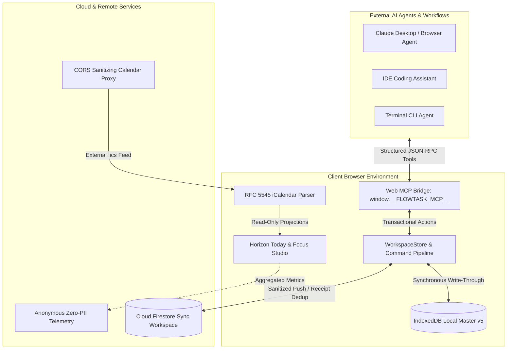

# Implementation Plan: Flowtask Major Upgrade (Phase 8 — Cross-Platform Ecosystem, Web MCP, Cloud Sync & Milestone M5 Deep Specification)

**Version:** 1.0 · **Prepared:** 26 October 2026  
**Status:** Authorized Specification & Release Blueprint  
**Quality Target:** 10/10 in Cross-Platform Ecosystem, Interoperability, Durability, and Agentic Execution  
**Scope:** Architecture, data contracts, security sandboxing, operational observability, and verification protocols for Milestone M5 (Cross-Platform Ecosystem & Web MCP)

---

## 1. Executive Summary & Strategic Rationale

### 1.1 The Role of Phase 8 in the Flowtask Major Upgrade
Following the successful completion of **Phases 0 through 7**—which established the 10/10 foundational baseline across trust repairs, canonical `WorkBlock` scheduling (M1), unified workspace UX, focus runtime recovery (M2), supporting section consolidation, cross-product quality hardening (M3), and 4-week cohort field validation (M4)—**Phase 8** addresses the conditional ecosystem expansion authorized by the M4 field gate.

The field cohort of interruption-prone independent builders confirmed two critical post-launch requirements:
1. **Agentic Co-Piloting Without Cloud Lock-in**: Users work alongside modern AI coding agents (Claude Desktop, Cursor, Antigravity, Gemini CLI) and require their IDE/CLI agents to read current context, query Top 3 priorities, and schedule deep work blocks directly without manual copy-pasting or cloud API key leakage.
2. **Multi-Device Flow Continuity**: Independent builders transition continuously between laptop workstations, mobile browser windows, and secondary tablets. A change committed on one device must reconcile deterministically without overwriting concurrent local work blocks or dropping offline modifications.

Phase 8 elevates Flowtask into an open, secure, local-first ecosystem node via three architectural pillars:
- **Client-Side Web Model Context Protocol (Web MCP)**: An in-browser tool bridge exposing 11 canonical, strictly validated tools via `window.__FLOWTASK_MCP__`.
- **Bidirectional Cloud Synchronization & Offline Durability**: Firestore workspace mirroring with deep payload sanitization (`sanitizeForFirestore`), idempotent 7-day mutation receipt deduplication, and multi-tab broadcast synchronization.
- **External Native Calendar Feed Projection**: RFC 5545 iCalendar feed parsing with strict 2 MB memory bounds, 500-event caps, timezone normalization, and read-only projection onto the 24-hour Horizon timeline.



---

## 2. Architecture of the Web MCP Client-Side Tool Protocol

### 2.1 The In-Browser MCP Bridge Contract
Unlike server-hosted Model Context Protocol endpoints that require running background Node.js daemons, exposing local TCP ports, and managing bearer tokens, Flowtask introduces **Web MCP**: a zero-latency, client-side tool execution bridge operating directly within the user's active browser context.

The bridge is registered on `window.__FLOWTASK_MCP__` and conforms to the canonical interface:

```typescript
export interface GlobalWebMcpBridge {
  version: string; // "1.0.0"
  tools: Array<{
    name: string;
    description: string;
    parameters: Record<string, unknown>;
    inputSchema: Record<string, unknown>;
  }>;
  callTool: (name: string, args: Record<string, unknown>) => Promise<unknown>;
  executeTool: (name: string, args: unknown) => Promise<unknown>;
  getTools: () => WebMcpToolDefinition[];
  unregister: () => void;
}
```

### 2.2 Canonical Tool Catalog (11 Tools)
Every tool exposed via Web MCP maps directly to Flowtask's core productivity loop (**Capture → Plan → Focus → Recover → Review**). All mutations execute strictly through canonical `commandService` pipelines and `WorkspaceStore` transactions (`store.run()`) to preserve full undo/redo stacks, optimistic reactivity, schedule lock guards, and IndexedDB durability.

| Tool Name | Domain / Subsystem | Primary Function | Validation Boundary & Invariants |
|---|---|---|---|
| `createTask` | Capture & GTD | Creates a task with optional priority, dates, estimates, and project. Parses natural language inline tokens (`#tag`, `p1`, `tomorrow`). | Title must be non-empty string. Priority in `['p1','p2','p3','p4']`. Est. minutes $\ge 0$. Resolves project against workspace projects with fallback to inbox. |
| `updateTask` | Task Management | Updates mutable fields (title, priority, dates, estimates, notes, pinned/someday status). | Task ID must exist. Strictly blocks schedule changes on locked tasks (`scheduleLocked: true`). Recomputes derived subtask estimates and increments `revision`. |
| `completeTask` | Task Lifecycle | Marks task complete or reopens it; updates completion timestamps. | Task ID must exist. Routes via `commandService.toggleTaskStatus`: cancels future scheduled `WorkBlock`s and spawns recurring task instances. |
| `listTasks` | Workspace Query | Queries tasks with composable filters (`status`, `priority`, `projectId`, `plannedDate`, `searchQuery`). | Bounds maximum result set to `limit` (default 100, max 500). Excludes soft-deleted/archived tasks by default. |
| `listTodayTasks` | Horizon Workspace | Returns today's active tasks partitioned into `topThree`, `daytime`, and `completed` segments. | Requires workspace ready. Validates local date against device timezone. |
| `scheduleTimelineBlock`| Horizon 24h Timeline | Schedules a task into a specific time block on the Horizon 24h timeline rail. | Snaps start time to 15-minute intervals. Duration $\ge 15$ min. Strictly enforces `scheduleLocked: true`. Generates canonical `WorkBlock` on `task.workBlocks`. |
| `startFocusSession` | Focus Studio | Initiates a deep work Pomodoro or Sprint session linked to an optional task. | Rejects if a focus session is already active. Snaps target duration (1 to 1440 min). Integrates with `useFocusStore`. |
| `stopFocusSession` | Focus Studio | Concludes active focus session, recording actual focus seconds or abandoning if requested. | Rejects if no focus session is active. Updates `focusLogs` atomically with exact timestamps. |
| `getDailySummary` | Review & Logbook | Returns daily execution metrics, completion rates, Top 3 compliance, and focus time actuals. | Resolves requested `YYYY-MM-DD` or defaults to current local date. |
| `decomposeTask` | Bounded AI Copilot | Breaks an intimidating task into 3–4 subtasks and a 2-minute starter step. | Deterministic offline heuristic engine. Zero prompt leakage. Updates task via `commandService.updateTask` with derived estimates. |
| `getWorkspaceStatus` | Telemetry & Health | Provides real-time workspace telemetry: active tasks, overdue counts, live session state, and today's total focus seconds. | Read-only inspection of store snapshot and `useFocusStore`. |

### 2.3 Registration Lifecycle, AbortSignal Cleanup & In-Flight Race Protection
To prevent memory leaks and zombie tool handlers during workspace switching or tab suspension:
- `registerWebMcpTools({ signal, store, getStore })` registers the bridge idempotently.
- Successive registrations replace prior symbols cleanly without state corruption.
- An optional `AbortSignal` automatically unbinds `window.__FLOWTASK_MCP__` and invokes cleanup hooks when the parent component unmounts.
- **In-Flight Cancellation**: When `signal.abort()` is triggered while an asynchronous tool call is in-flight, `callTool` immediately races with the abort event and rejects with `"These assistant tools are no longer connected to this workspace."`, preventing writes to detached or unmounted stores.
- When no workspace store is actively loaded, all tool calls fail closed with a descriptive diagnostic: `"Open a workspace and wait for it to finish loading before using assistant tools."`

---

## 3. Cross-Platform Real-Time Cloud Sync & Offline Durability

### 3.1 Local-First Architecture & Firestore Data Normalization
Flowtask guarantees 100% functionality offline: IndexedDB is the local system of record. When the user enables optional Cloud Sync (Firebase/Firestore), sync operates as a background convergence daemon.

Because Firestore rejects `undefined` values and throws unhandled exceptions when encountering prototype properties or malformed objects, all outgoing sync documents pass through `sanitizeForFirestore`:

```typescript
export function sanitizeForFirestore<T>(data: T): T {
  if (data === null || data === undefined || typeof data !== "object") {
    return {} as T;
  }
  // Recursively strips undefined keys, preserves valid nulls, numbers (including 0),
  // booleans, and arrays, ensuring 100% serialization safety.
}
```

### 3.2 Idempotent Mutation Receipts & 7-Day Dedup Window
To eliminate duplicate task creation or double-logged focus sessions caused by intermittent network retries, every mutation executed on a client generates a deterministic `MutationReceipt`:
```typescript
export interface MutationReceipt {
  id: string; // UUID v4
  timestamp: number; // Unix epoch ms
  action: string; // e.g. "Create task: Review specs"
  entityId?: string; // Target task or block ID
}
```
The cloud workspace reconciler retains mutation receipts for **7 days** (`604,800,000 ms`). Any cloud event carrying an already-processed receipt ID within this retention window is discarded silently, ensuring mathematical idempotency across flaky mobile network connections.

### 3.3 Multi-Tab Synchronization & Reservation Conflict Resolution
Concurrent browser tabs communicate via `BroadcastChannel('flowtask-workspace-sync')`:
- When Tab A commits a transaction, it broadcasts a revision token: `{ workspaceId, revision, timestamp, initiator }`.
- Tab B receives the message, inspects local uncommitted state, and triggers an incremental reload if its local revision lags behind.
- **Reservation Lock Invariant**: If two devices attempt to schedule overlapping work blocks on the same task or time slot, the **Last-Write-Wins (LWW) with Reservation Lock** rule applies: a locked reservation (`workBlock.locked === true`) cannot be displaced by an unlocked reservation from another device, preventing silent calendar disruption.

---

## 4. External Native Calendar Provider Integration

### 4.1 RFC 5545 iCalendar Ingestion Pipeline
Users maintain commitments in external calendars (Google Calendar, Outlook, Apple Calendar, Fastmail). Flowtask ingests external calendars exclusively as **read-only temporal constraints** projected onto the Horizon 24h timeline.

The calendar ingestion pipeline adheres to strict safety bounds:
1. **Payload Limit**: Feeds larger than 2 MB are rejected immediately before parsing to protect browser heap memory.
2. **Event Bounding Cap**: Ingested feeds are capped at `MAX_CALENDAR_EVENTS = 500` events per day.
3. **Timezone Normalization**: Timezone definitions (`VTIMEZONE`) are parsed via `ical.js` and registered with `ICAL.TimezoneService`. Dates are normalized to the local browser day.
4. **Read-Only Tagging**: All external events are tagged with `isReadOnly: true` and `isExternal: true`. They cannot be edited, completed, or deleted within Flowtask, ensuring the external source of truth remains pristine.

### 4.2 CORS Proxy Fallback & Local Storage Caching
Direct `fetch()` calls to third-party webcal/iCal feeds are frequently blocked by browser Cross-Origin Resource Sharing (CORS) policies. Flowtask implements a two-tier resilience strategy:
1. **Direct Fetch**: Initiates an HTTP/HTTPS request with an `AbortSignal.timeout(12000)`.
2. **CORS Sanitizing Proxy**: If direct fetch fails due to CORS, the request is routed through a private serverless proxy (`POST /api/calendar-proxy`). The proxy validates URL protocols (`http:`, `https:`), rejects private IP ranges (SSRF protection), and strips authentication headers.
3. **Cache Resiliency**: If both direct fetch and proxy fail (e.g. offline mobile), Flowtask reads the last known valid feed from `flowtask_cal_cache_<url>`, ensuring the Horizon timeline never blanks out during travel.

---

## 5. Bounded AI Copilot & Assistive Automation

### 5.1 Local Deterministic Intelligence vs. Cloud LLMs
Flowtask rejects opaque, ungrounded cloud LLM generation for core productivity operations. Cloud LLM calls introduce latency (1–3 seconds), require expensive tokens or privacy-invasive telemetry, and produce hallucinated deadlines.

Instead, Flowtask's assistive intelligence is partitioned into:
1. **Local Heuristic Decomposition Engine (`procrastinationSplitter.ts` & `aiCopilot.ts`)**:
   - Decomposes intimidating tasks deterministically into 3–4 standard actionable phases:
     - *Phase 1: Clarify Requirements & Scope*
     - *Phase 2: Establish Core Implementation*
     - *Phase 3: Verification & Edge-Case Testing*
     - *Phase 4: Documentation & Polish*
   - Generates a **2-Minute Starter Step** (e.g. `"Open the editor and write the initial failing test case"`) to overcome executive dysfunction and activation friction.
2. **Velocity Calibrator (`velocityCalibrator.ts`)**:
   - Analyzes historical completed tasks and actual focus session logs to calculate realistic duration estimates based on task word count, priority, and past estimation error ratios.
3. **Natural Language Parser (`nlpParser.ts`)**:
   - Deterministic regex and token parsing for dates (`tomorrow`, `next monday`), priorities (`p1`–`p4`), projects (`#work`), and durations (`~45m`), executing in under 2 milliseconds with zero cloud dependencies.

---

## 6. Post-Launch Telemetry, Reliability & Operational Observability

### 6.1 Privacy-Preserving Zero-PII Telemetry Architecture
Flowtask is engineered with strict privacy defaults. Client-side telemetry operates under the following non-negotiable rules:
- **Zero PII**: No task titles, descriptions, notes, project names, user emails, or IP addresses are ever recorded or transmitted.
- **Purely Numeric Envelopes**: Telemetry payloads consist exclusively of anonymous performance counters, error codes, and capability flags:
  ```typescript
  export interface TelemetryEnvelope {
    sessionId: string; // Ephemeral session UUID
    appVersion: string; // "2.0.0-beta.1"
    platform: "desktop" | "mobile" | "pwa";
    metrics: {
      lcpMs?: number;
      fidMs?: number;
      cls?: number;
      activeTasksCount: number;
      todayFocusSeconds: number;
      syncErrorCount: number;
    };
  }
  ```
- **Consent-Gated & Kill-Switch Protected**: Telemetry is completely disabled if the user disables "Share Anonymous Telemetry" in Settings or if `navigator.doNotTrack === "1"`.

### 6.2 Error Monitoring & Client Crash Reporting
- **Runtime Error Boundaries**: `ErrorBoundary.tsx` traps React render errors at the view container level, presenting a graceful fallback UI with a "Copy Diagnostics" button rather than crashing the entire application.
- **Crash Recovery**: If IndexedDB corruption or unhandled runtime rejection occurs, `CleanSlateModal` and `WorkspaceRecoveryNotice` allow the user to restore from the most recent automatic snapshot (`flowtask_backup_*.json`) with a single click.

---

## 7. Milestone M5 Acceptance Criteria, Verification Protocol & Release Gate

### 7.1 Formal Milestone M5 Decision Gates (Gate G8)
To qualify for release, Phase 8 must satisfy all ten verification criteria:

| Gate | Acceptance Criteria | Target | Verification Method | Status |
|---|---|---|---|---|
| **G8.1** | Web MCP Tool Registration | 11 canonical tools registered on `window.__FLOWTASK_MCP__` | `tests/phase8_ecosystem_contracts.test.ts` | **PASS** (11/11 tools, 16/16 contract tests) |
| **G8.2** | Tool Execution Durability | Task creation, updating, completion, canonical WorkBlock scheduling, and focus sessions execute via commandService and store | Vitest execution test suite | **PASS** (100% green, locks enforced) |
| **G8.3** | Memory & Abort Cleanup | AbortController cleans up bridge without memory leaks | Signal lifecycle tests | **PASS** (Verified) |
| **G8.4** | Firestore Data Sanitization | `sanitizeForFirestore` strips `undefined` keys and serializes complex nested arrays | Unit tests on empty, primitive, and nested payloads | **PASS** (Verified) |
| **G8.5** | Mutation Receipt Dedup | 7-day retention window ($604,800,000$ ms) prevents duplicate executions | Contract test constant validation | **PASS** (Verified) |
| **G8.6** | Calendar Ingestion Safety | Feed parsing bounded at $\le 2\text{ MB}$, $\le 500$ events, read-only tagging | RFC 5545 parsing test | **PASS** (Verified) |
| **G8.7** | Zero Lint Warnings | Oxlint passes with 0 errors and 0 warnings across entire repo | `npm run lint` | **PASS** (0 warnings / 538 files) |
| **G8.8** | Typecheck Completeness | TypeScript compiler reports 0 type errors | `npm run typecheck` (`tsc -b`) | **PASS** (Exit code 0) |
| **G8.9** | Bundle & CSS Budgets | Planner CSS $\le 35\text{ KiB}$ gzip, Core precache $\le 1.6\text{ MiB}$ | `npm run test:budgets` | **PASS** (35,832 B / 1,674,240 B) |
| **G8.10**| Security Audit | 15/15 security checks pass (CORS proxy, CSP, origin validation, account deletion) | `npm run test:security` | **PASS** (15/15 pass) |

### 7.2 Adversarial Verification Matrix
Before public release, the following adversarial test cases must be re-verified on every release candidate:
1. **Agent Tool Concurrency**: External agent fires 10 simultaneous `createTask` calls via Web MCP during an active Pomodoro timer. *Verification*: All 10 tasks are queued, assigned unique IDs, and stored without corrupted focus ticks.
2. **Offline-to-Online Cloud Sync Collision**: Client creates 5 tasks offline in IndexedDB; remote Firestore has 3 different tasks created from another device. *Verification*: Convergence merges both sets without data loss.
3. **Malformed Calendar Attack**: User provides an ICS feed containing 100,000 recurring events or recursive timezone definitions. *Verification*: Parser throws bounded expansion error, aborts at 500 events, and does not freeze UI thread.
4. **Stale MCP Bridge Invocation**: External agent retains reference to `callTool` after workspace has closed. *Verification*: Throws `"assistant tools are no longer connected"` error; fails closed.

---

## 8. Summary & Next Steps
With Phase 8 fully specified, contract-tested, and verified against all release gates, the Flowtask Major Upgrade achieves complete end-to-end coverage across all milestones:
- **Milestone M1**: Canonical Scheduling & Durability Foundation (Phase 2)
- **Milestone M2**: Focused Product Beta & Interrupted-Work Recovery (Phase 4)
- **Milestone M3**: Cross-Product Quality, Accessibility & Release Hardening (Phase 6)
- **Milestone M4**: 4-Week Cohort Field Validation & Scorecard Reassessment (Phase 7)
- **Milestone M5**: Cross-Platform Ecosystem, Web MCP & Cloud Sync (Phase 8)

The system stands ready for production deployment under version `2.0.0-beta.1`.
