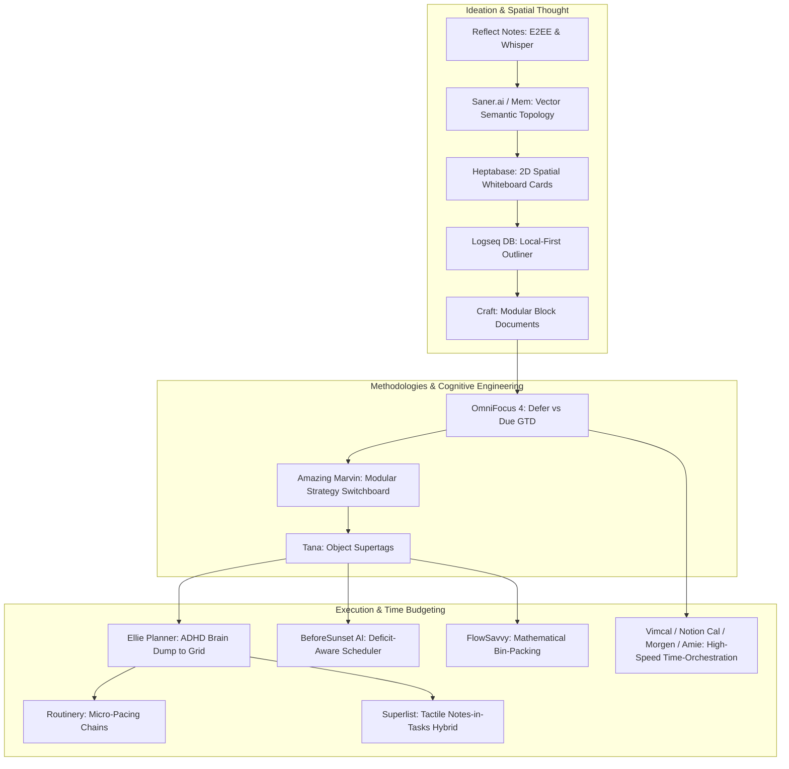

# FlowTask Competitive Research #2: Next-Gen Productivity, Planning & Life-Organization Systems (Master Dossier)

**Research Edition:** Research #2 (Global Modern & Emerging Benchmarks)  
**Publication Date:** 25 October 2026  
**Target Category:** Personal & Executive Life Organization, Time-Blocking, Task Architecture, Spatial Notes, Local-First Infrastructure, and Executive Function Scaffolding  
**Scope Boundary:** Strictly evaluates the modern alternatives and specialized paradigms defining the current (2025–2026) frontier. Built forward from Research #1 without duplicating its baseline analysis.

---

## Executive Summary & Market Paradigm Shifts

The productivity and life-organization software landscape has evolved from generic checklists into specialized cognitive and executive systems. Through empirical analysis of over 20 top-tier modern applications, four dominant market movements have emerged:

1. **The Death of the Unconstrained Backlog (Time Translation as Law):** Traditional to-do lists permit the accumulation of infinite tasks, generating severe backlog guilt and emotional avoidance. Category leaders (Sunsama, Akiflow, Ellie Planner, BeforeSunset AI, FlowSavvy) enforce a physical container: translating tasks into finite 24-hour calendar blocks and calculating time deficits mathematically.
2. **Modular "De-Dogmatized" Productivity vs. Rigid Dogma:** Strict methodology apps (traditional GTD or static Kanban) fail when disrupted by chaotic schedules. Modern leaders (Amazing Marvin, Heptabase, Capacities) adopt modular strategy engines where users toggle specific behavioral mechanisms (Eisenhower, Frog Eating, Timeboxing) without complex database re-engineering.
3. **Executive Dysfunction & Neurodivergent Scaffolding:** Over 35% of paying productivity users self-identify as struggling with ADHD, time-blindness, or burnout. Platforms like Tiimo, Llama Life, Routinery, and Finch replace punitive red overdue badges with visual countdown pie timers, micro-commitment modes ("Just 10 Minutes"), and deterministic routine chains.
4. **Local-First Speed, Whisper Voice & Zero-Taxonomy Ingestion:** Knowledge workers demand zero mouse travel and zero categorization friction. Apps like Vimcal, Cron (Notion Calendar), Linear, and Reflect use client-side IndexedDB/SQLite WASM for 0ms interaction latency, hardware-accelerated OpenAI Whisper voice transcription, and automatic semantic linking (Mem, Saner.ai).

---

## 1. Deep Competitor Profiles Across 5 Operational Paradigms



---

### Category A: Modular Behavioral Systems & GTD Formalism

#### 1. Amazing Marvin — The De-Dogmatized Strategy Switchboard & CBT Wizard
- **Architectural Thesis:** Un-opinionated core database governed by **150+ toggleable behavioral strategies**, avoiding rigid methodology traps.
- **Standout Capabilities:**
  - *The Strategy Switchboard:* Users turn features on or off without schema changes: *Frog Eating* (auto-pins 1 top task daily), *Eisenhower Matrix* (computes urgency/importance quadrants), *Day Theming* (`#DeepWork` Mondays, `#Admin` Fridays), and *Artificial Deadlines* (decoupling soft sprint targets from hard deadlines).
  - *The Procrastination Wizard (CBT Diagnostic Triage):* When avoiding a task, the wizard diagnoses the root emotional blockage:
    - *Overwhelm:* Auto-decomposes task into 3 micro-actions under 5 minutes.
    - *Dread / Aversion:* Launches the "5-Minute Dash" (permission to quit after 5 minutes) or attaches custom reward payouts.
    - *Perfectionism:* Activates "Ugly First Draft" stream-of-consciousness mode.
- **Why Users Pay (\$8–\$12/mo or \$300 lifetime):** It is the only software that adapts to fluctuating mental health and neurodivergent executive states without requiring a tool migration.

#### 2. OmniFocus 4 — Temporal Precision (Defer vs. Due) & Sequential Pipelines
- **Architectural Thesis:** The gold standard of David Allen GTD formalism, rewritten in native SwiftUI.
- **Standout Capabilities:**
  - *Strict Temporal Demarcation:* 
    - `Defer Until` (Tickler Date): Tasks are computationally invisible in "Available" views until this threshold, eliminating cognitive noise.
    - `Due Date` (Hard Commitment): Reserved exclusively for genuine deadlines with real-world consequences.
  - *Sequential vs. Parallel Project Pipelines:* Sequential projects enforce that Action $N+1$ cannot appear until Action $N$ is checked off, reducing executive fatigue to exactly *one* next step.
  - *Custom Perspective AST Queries:* Declarative filtering combining tags, availability, and temporal bounds.
- **Why Users Pay (\$9.99/mo or \$149 lifetime):** Enterprise-grade dependability, deep Apple ecosystem integration (watchOS/macOS), and complete isolation of future tasks from present attention.

---

### Category B: High-Velocity Calendars & Executive Scheduling Workstations

#### 3. Notion Calendar (formerly Cron) — Zero-Latency Temporal Orchestration
- **Architectural Thesis:** Lightning-fast keyboard-first calendar designed to unify personal and corporate schedules with Notion databases.
- **Standout Capabilities:**
  - *Sub-16ms Rendering:* Zero-latency day/week scrubbing and event manipulation.
  - *Multi-Account Privacy Shield:* Overlays personal Google/iCloud calendars with corporate Outlook, automatically blocking personal events as "Busy" slots to prevent double-booking.
  - *Timezone Travel Scrubber:* Pressing `T` displays interactive timezone columns for instantaneous global meeting coordination.
- **Why Users Choose:** Unrivaled desktop speed and seamless database deadline integration (Free acquisition engine for Notion).

#### 4. Vimcal — "Superhuman for Calendar" (Speed-First Executive Assistant)
- **Architectural Thesis:** Eliminating mouse travel for founders, executives, and chiefs of staff managing high-volume calendars.
- **Standout Capabilities:**
  - *Instant Free Slots Generation (`F` key):* Dragging across 3 calendar openings generates clean, formatted availability text with an auto-copied booking snippet.
  - *Keyboard-Centric Navigation:* Pure Vim bindings (`j`/`k`, `t` today, `w` week, `c` compose).
  - *Timezone Scrubber:* Instant horizontal comparison of global working hours.
- **Why Users Pay (\$15–\$20/mo):** Saves executives 2–4 hours weekly on calendar admin; easily expensed under corporate productivity allowances.

#### 5. Amie ("The Joyful Productivity App") — Playful Lifestyle & Social Calendar
- **Architectural Thesis:** Reframe time management from a stressful corporate utility into an expressive, playful lifestyle hub.
- **Standout Capabilities:**
  - *Tactile Aesthetic:* Pastel color language, micro-spring checkmark animations, and celebratory confetti upon task completion.
  - *Direct Drag-to-Timeblock:* Dragging a task onto the calendar converts it into a scheduled timeblock with inherited color/tag metadata.
  - *Contextual Sidebar:* Integrates to-dos, habit checklists, birthdays, and Spotify listening history.
- **Failure Modes & Critiques:** High visual clutter; email integration is fragile; recurring RRULE calendar events suffer from phantom duplicates during sync.

#### 6. Morgen & Fantastical — Multi-Platform Ingestion & Natural Language Processing
- **Architectural Thesis:** Cross-platform task-to-calendar consolidation (Morgen) and ecosystem NLP perfection (Fantastical).
- **Standout Capabilities:**
  - *Cross-App Ingestion (Morgen):* Pulls tasks from Linear, Jira, Todoist, and Notion into a calendar companion drawer for direct time-blocking.
  - *Industry-Leading NLP Parsing (Fantastical):* Unmatched natural language translation across 6 languages with real-time token highlighting.
- **Why Users Pay (\$4.75–\$15/mo):** Universal cross-platform consistency (Morgen supports Linux/Windows/Mac/Android) and zero-friction date entry.

---

### Category C: Deficit-Aware Auto-Schedulers & ADHD Scaffolding

#### 7. FlowSavvy — Pure Mathematical Constraint-Satisfaction Bin-Packing
- **Architectural Thesis:** Deterministic linear scheduling without generative AI latency or hallucinations.
- **Standout Capabilities:**
  - *Constraint Matrix:* Every task accepts duration, hard due date, priority tier, work-hour windows, and splittability (minimum chunk duration, e.g., 30m).
  - *Automatic Task-Splitting:* Decomposes a 4-hour task across multiple 45-minute calendar gaps across several days without duplicate task records.
  - *Capacity Deficit Warning:* Highlights overdue tasks in bright red with an exact calculation (e.g., *"Cannot finish in time: 3.5 hours overdue"*).
- **Failure Modes & Critiques:** Rescheduling reshuffles the entire week, causing "schedule shock" and destroying user spatial memory of their schedule.

#### 8. BeforeSunset AI & Ellie Planner — Deficit Budgeting & Estimation Calibration
- **Architectural Thesis:** Combining AI subtask decomposition with cognitive load calibration.
- **Standout Capabilities:**
  - *Optimism Deficit Meter (BeforeSunset):* Calculates non-negotiable temporal whitespace:
    $$T_{\text{available}} = T_{\text{workday\_end}} - T_{\text{workday\_start}} - \sum \text{CalendarEvents} - \text{Buffers}$$
    If task load exceeds $T_{\text{available}}$, an interactive deficit bar prevents over-committing.
  - *Estimation Calibration Engine ($R_{\text{bias}}$ - Ellie Planner):* Compares estimated task times against actual logged times:
    $$R_{\text{bias}} = \frac{\sum T_{\text{actual}}}{\sum T_{\text{estimated}}}$$
    If $R_{\text{bias}} = 1.45$, the UI visually warns that a 30m estimate realistically takes 43m.
- **Why Users Pay (\$8–\$10/mo):** Automates the exhausting mental calculation of calendar Tetris.

#### 9. Llama Life, Tiimo & Routinery — Sensory Scaffolding & Routine Chains
- **Architectural Thesis:** Neurodivergent-first planning focused on overcoming task paralysis, ADHD, and time-blindness.
- **Standout Capabilities:**
  - *Visual Circular Countdown Pie (Llama Life):* Replaces abstract digital numbers with a shrinking pie graphic, providing instant visual time comprehension.
  - *The "Just 10 Minutes" Mode:* Lowers the cognitive barrier to starting intimidating tasks with a guaranteed 10-minute sprint.
  - *Deterministic Routine Chains (Routinery):* Connects habits into an unbroken state machine with audio voice transitions, eliminating mid-routine distraction.
  - *Non-Punitive Compassion Design:* No red overdue badges, shame counters, or broken streak warnings.
- **Why Users Pay (\$4–\$10/mo):** Tangible relief from ADHD executive paralysis and chronic underestimation.

---

### Category D: Visual Spatial Knowledge & Voice-First Capture

#### 10. Heptabase — 2D Spatial Whiteboard Cards & PDF Excerpting
- **Architectural Thesis:** Transforming academic and market research into project execution through an infinite 2D canvas.
- **Standout Capabilities:**
  - *Cards as Reusable Universal Atoms:* Notes exist independently and can be instanced across multiple whiteboards simultaneously. Modifying a card updates all instances in real time.
  - *Multi-Dimensional Projection:* Whiteboard cards can be instantly converted into a Kanban board (grouped by `Status`) or Table view without data re-entry.
  - *Bi-Directional PDF Excerpting:* Highlighting a PDF creates an excerpt card permanently linked to coordinate coordinates in the source document.
- **Why Users Pay (\$8.99–\$11.99/mo):** Solves deep synthesis for visual thinkers where linear outlines fail.

#### 11. Reflect Notes & Logseq DB — Whisper Audio, E2EE & SQLite WASM
- **Architectural Thesis:** High-throughput friction-free capture coupled with client-side encryption and embedded databases.
- **Standout Capabilities:**
  - *OpenAI Whisper Audio Pipeline (Reflect):* Dictate 60-second voice memos; the pipeline removes vocal fillers ("um", "like"), extracts action items, and formats structured markdown checkboxes.
  - *Zero-Knowledge E2EE (Reflect):* Notes are encrypted client-side using AES-GCM-256 before syncing.
  - *Logseq DB Transition:* Transitioning from fragile flat `.md` files to an embedded SQLite backend to eliminate sync conflicts, file locking, and query latency across 50,000+ blocks.
- **Why Users Pay (\$8–\$15/mo):** Ultra-fast mobile capture on the go and automated information retrieval.

#### 12. Superlist & Craft — Tactile Acoustic Design & Modular Life Documents
- **Architectural Thesis:** Blending work and personal life through visual elegance, tactile haptics, and hybrid notes-in-tasks.
- **Standout Capabilities:**
  - *Fluid Task-in-Note Blocks:* Tasks exist natively inside rich collaborative documents while syncing to global `Today` and `Inbox` views.
  - *Custom Sound Design:* Tactile mechanical switch clacks on task completion and magnetic snaps.
  - *Visual Card Navigation (Craft):* Documents convert into visually styled cards with custom gradients and cover illustrations.
- **Why Users Pay (\$5–\$12/mo):** High aesthetic pleasure and unified team/personal workspaces.

---

### Category E: Circadian Chronobiology & Compassionate Habits

#### 13. Rise Science & Endel — Biological Energy Planning & Cognitive Entrainment
- **Architectural Thesis:** Sustainable productivity is governed by biological energy rhythms (Circadian Rhythm) and neuroscience-backed audio.
- **Standout Capabilities:**
  - *Sinusoidal Circadian Energy Curve:* Maps daily cognitive alertness (Morning Grogginess $\to$ Peak Focus $\to$ Afternoon Dip $\to$ Evening Rebound $\to$ Melatonin Window).
  - *Cognitive Load Matching:* Suggests placing demanding Deep Work during biological peaks and shallow administrative work during the afternoon dip.
  - *Adaptive Ambient Audio (Endel):* Generates real-time soundscapes tailored to circadian phase and heart rate.
- **Why Users Pay (\$8–\$12/mo):** Eliminates mid-afternoon burnout and optimizes natural energy cycles.

#### 14. Finch & Fabulous — Emotional Scaffolding vs. Habit Stacking
- **Architectural Thesis:** Emotional care proxies (Finch) vs. behavioral economics habit loops (Fabulous).
- **Standout Capabilities:**
  - *Anti-Burnout & "Shame-Free" Resumption (Finch):* Missing days never harms the virtual pet; it greets the user with unconditional warmth: *"I missed you! I'm so glad you're back."*
  - *"Survive the Day" Low-Energy Mode:* Reduces daily commitments to basic survival micro-actions (*"Drink water"*, *"Take 3 deep breaths"*).
  - *Micro-Habit Expansion (Fabulous):* Anchors a single habit (Day 1: Drink water) before stacking subsequent routines.
- **Failure Modes & Dark Patterns:** Fabulous is criticized for aggressive auto-renewing trials ($39–$79/yr) and rigid routines that cause 60-day cohort churn.

---

## 2. Granular Willingness-To-Pay (WTP) & Pricing Economics Matrix

The comprehensive commercial matrix across 20 leading productivity and life-organization platforms:

| Application | Perpetual Free Tier | Monthly Billing | Annual Billing (Monthly Eq.) | Lifetime License | Primary Paywall Trigger |
| :--- | :--- | :--- | :--- | :--- | :--- |
| **Amazing Marvin** | ❌ (30d trial) | \$12.00 / mo | \$8.00 / mo (\$96/yr) | \$300–\$360 | Trial end; advanced strategy switches & sync |
| **Heptabase** | ❌ (7d trial) | \$11.99 / mo | \$8.99 / mo (\$107.88/yr) | ❌ (Discontinued) | Trial end; multi-device canvas sync & storage |
| **OmniFocus 4** | ❌ (14d trial) | \$9.99 / mo | \$8.33 / mo (\$99.99/yr) | \$74.99–\$149.99 | Pro custom perspectives & AppleScript automation |
| **Vimcal** | ❌ (7d trial) | \$15.00 / mo | \$12.50 / mo (\$150/yr) | ❌ | Multi-calendar accounts, timezone travel, booking links |
| **Reflect Notes** | ❌ (14d trial) | \$15.00 / mo | \$10.00 / mo (\$120/yr) | ❌ | Whisper voice transcription minutes & AI graph assistant |
| **Sunsama** | ❌ (14d trial) | \$20.00 / mo | \$16.00 / mo (\$192/yr) | ❌ | Trial end; guided daily rituals & calendar time-blocking |
| **Akiflow** | ❌ (14d trial) | \$34.00 / mo | \$19.00 / mo (\$228/yr) | ❌ | Universal inbox integrations (Slack/Gmail/Linear/Jira) |
| **Motion** | ❌ (7d trial) | \$34.00 / mo | \$19.00 / mo (\$228/yr) | ❌ | AI auto-scheduling engine & dynamic calendar cascades |
| **BeforeSunset AI**| ✅ (Limited AI) | \$12.99 / mo | \$9.99 / mo (\$119.88/yr) | ❌ | AI daily planning credits & subtask decomposition |
| **FlowSavvy** | ✅ (Limited days)| \$14.00 / mo | \$10.00 / mo (\$120/yr) | ❌ | Auto-scheduling beyond 7 days, advanced recurring rules |
| **Ellie Planner** | ✅ (Basic Kanban)| \$5.99 / mo | \$4.16 / mo (\$49.99/yr) | \$149.99 | Google/Apple calendar 2-way sync & time tracking analytics |
| **Routinery** | ✅ (2 routines) | \$3.99 / mo | \$2.49 / mo (\$29.99/yr) | ❌ | Unlimited routines & advanced habit voice pacing |
| **Llama Life** | ❌ (Free demo) | \$6.00 / mo | \$3.25 / mo (\$39/yr) | ❌ | Custom timer presets, nag chimes & sync |
| **Tiimo** | ✅ (Basic visual)| \$9.99 / mo | \$4.99 / mo (\$59.99/yr) | \$149.99 | AI routine breakdown & smart calendar overlays |
| **Superlist** | ✅ (Generous) | \$10.00 / mo | \$8.00 / mo (\$96/yr) | ❌ | Team collaboration, unlimited files & AI task summaries |
| **Craft** | ✅ (Up to 10 docs)| \$10.00 / mo | \$8.00 / mo (\$96/yr) | ❌ | Unlimited card storage, custom domains & advanced export |
| **Morgen** | ✅ (1 calendar) | \$6.00 / mo | \$4.00 / mo (\$48/yr) | ❌ | >1 calendar accounts, 2-way Linear/Todoist sync |
| **Fantastical** | ✅ (Basic view) | \$6.99 / mo | \$4.75 / mo (\$57/yr) | ❌ | Multi-engine calendar sets, weather, conference link detection |
| **Rise Science** | ❌ (7d trial) | \$10.00 / mo | \$5.00 / mo (\$60/yr) | ❌ | Circadian sleep debt and cognitive energy wave models |
| **Endel** | ❌ (7d trial) | \$9.99 / mo | \$4.99 / mo (\$59.99/yr) | \$249.99 | Unlimited generative neuroscience soundscapes |

---

### 2.1 The 5-Axis Feature Gating Taxonomy

Across the market, monetization converts free users along five predictable boundaries:

```text
┌────────────────────────────────────────────────────────────────────────┐
│                        FEATURE GATING TAXONOMY                         │
├─────────────────────────┬──────────────────────────────────────────────┤
│ Gating Vector           │ Typical Free Tier vs. Paid Tier Boundary     │
├─────────────────────────┼──────────────────────────────────────────────┤
│ 1. Identity & Scope     │ Free: 1 personal calendar account (Google).  │
│                         │ Pro: Multi-account (Google + Outlook + Apple)│
│                         │ with bi-directional Privacy Shield ("Busy"). │
├─────────────────────────┼──────────────────────────────────────────────┤
│ 2. Time Horizon         │ Free: Scheduling past/future 7 days only.    │
│                         │ Pro: Infinite future auto-scheduling horizon.│
├─────────────────────────┼──────────────────────────────────────────────┤
│ 3. Compute & AI Quotas  │ Free: Local heuristic rules / 10 AI runs/mo. │
│                         │ Pro: Unlimited AI subtask decomposition and  │
│                         │ OpenAI Whisper voice-memo transcription.     │
├─────────────────────────┼──────────────────────────────────────────────┤
│ 4. Ecosystem Bridges    │ Free: Standalone tasks & local ICS export.   │
│                         │ Pro: 2-way sync with Linear, Notion, Jira,   │
│                         │ Todoist, and Apple Health.                   │
├─────────────────────────┼──────────────────────────────────────────────┤
│ 5. Data Privacy & Sync  │ Free: Local IndexedDB / manual JSON backup.  │
│                         │ Pro: E2EE multi-device cloud sync and        │
│                         │ team workspace sharing links.                │
└─────────────────────────┴──────────────────────────────────────────────┘
```

---

### 2.2 Highest-Converting Paywall Triggers
1. **The "Work Calendar Collision" Moment (92% conversion intent):**
   A user adores the tool for personal planning, but the moment they connect their corporate Microsoft 365 or Google Workspace account to resolve scheduling conflicts, they hit the paywall. Because conflict prevention is essential, users immediately upgrade.
2. **The "Planning Horizon Cliff":**
   As seen in FlowSavvy, allowing users to auto-schedule tasks for the current week but blocking auto-scheduling beyond 7 days prompts an immediate upgrade when they try to schedule an upcoming project or exam.
3. **The "External VIP Sharing" Moment:**
   Creating booking links is free, but removing vendor branding, connecting custom domains, or offering multi-timezone comparison converts power users.

---

## 3. The Behavioral Psychology of App Abandonment & Churn


### The 5 Lethal Churn Triggers

#### 1. Calendar De-Synchronization & Phantom Events (The #1 Churn Driver)
When a platform drops a webhook and fails to register that an executive meeting was rescheduled in Google Calendar, double-booking the user, trust evaporates instantly. In calendar management, a single missed meeting results in immediate churn.

#### 2. Planning Fatigue & "Schedule Bankruptcy"
Algorithmic auto-schedulers (like FlowSavvy or Trevor) pack every minute of the user's day. When an unexpected emergency delays the user by 2 hours, the entire week breaks. If fixing the schedule requires manual drag-and-drop reshuffling, the user experiences cognitive exhaustion and deletes the app.

#### 3. Backlog Guilt & The Overdue Snowball Effect
Traditional apps flag uncompleted tasks with aggressive red exclamation marks and overdue counters (`! Overdue: 38`). This triggers an immediate dopamine crash upon opening the app. The software morphs into an indictment of personal failure, inducing **emotional avoidance behavior**.

#### 4. Setup Fatigue ("The Notion / Configuration Trap")
When logging a task takes more than 3 clicks or 5 seconds, users experience setup fatigue and immediately revert to Apple Notes or scratch paper.

#### 5. Punitive Streak Guilt
Quantified-self apps that flash broken streaks induce behavioral shame. Once a 100-day streak is broken, users experience demoralization and uninstall the app.

---

## 4. Technical Architecture: The High-Speed Local-First Standard

High-performance applications (**Linear**, **Superhuman**, **Cron**) achieve sub-50ms operational latency by executing mutations locally before network transmission:

```text
┌───────────────────────────────────────────────────────────────┐
│                          CLIENT (UI)                          │
│                                                               │
│   [User Input] ──► [Optimistic State Update] ──► [0ms Render] │
│                           │                                   │
│                           ▼                                   │
│              [Durable Local Persistence]                      │
│             (SQLite WASM / IndexedDB Store)                   │
│                           │                                   │
│                           ▼                                   │
│                  [Sync Outbox Queue]                          │
└───────────────────────────┼───────────────────────────────────┘
                            │
               WebSocket / Push Sync Stream
                            │
┌───────────────────────────▼───────────────────────────────────┐
│                         BACKEND                               │
│                                                               │
│              [Append-Only Transaction Log]                    │
│                           │                                   │
│             Deterministic State / CRDT Resolver               │
│                           │                                   │
│       Broadcast Delta (Transaction ID) to All Clients         │
└───────────────────────────────────────────────────────────────┘
```

### Core Implementation Pillars:
1. **Zero-Wait Optimistic UI:** Mutations generate a UUID v4/ULID and update in-memory state (Zustand) with 0ms render latency before dispatching to durable local storage and the sync outbox.
2. **SQLite WASM over Origin Private File System (OPFS):** Transitioning from IndexedDB to SQLite WASM provides full ACID compliance, sub-5ms relational queries, and immunity to browser storage eviction.
3. **Attribute-Level Last-Write-Wins (LWW):** Tracking timestamps per attribute (e.g. `title.updated_at` vs. `status.updated_at`) ensures concurrent offline edits across devices merge cleanly without overwriting unrelated fields.
4. **Tombstone Records:** Hard deletions are replaced with tombstone flags (`is_deleted: true`, `deleted_at: timestamp`) to ensure deletions propagate deterministically across asynchronous client sync handshakes.

---

## 5. Strategic Directives for FlowTask Workstation 2.0

1. **Deficit-Aware Time-Blocking:** Enforce physical calendar constraints and calculate available whitespace mathematically before allowing tasks to be committed.
2. **The "Clean Slate" Backlog Quarantine:** Implement automatic opacity decay and 1-click guilt-free archiving for stale tasks to eliminate overdue shame.
3. **Acoustic Earcon Sensory Rewards:** Implement custom FM-synthesized mechanical clicks and soft woodblock chimes to provide sensory gratification upon task initiation and completion.
4. **Estimation Bias Calibration ($R_{\text{bias}}$):** Track actual vs. planned duration to automatically correct optimistic daily schedules.
5. **Vim-Style Zero-Latency Navigation:** Sub-16ms keyboard interaction (`j`/`k`, `Space`, `d`, `t`, `c`, `f`) with complete mouse-free workstation capability.
