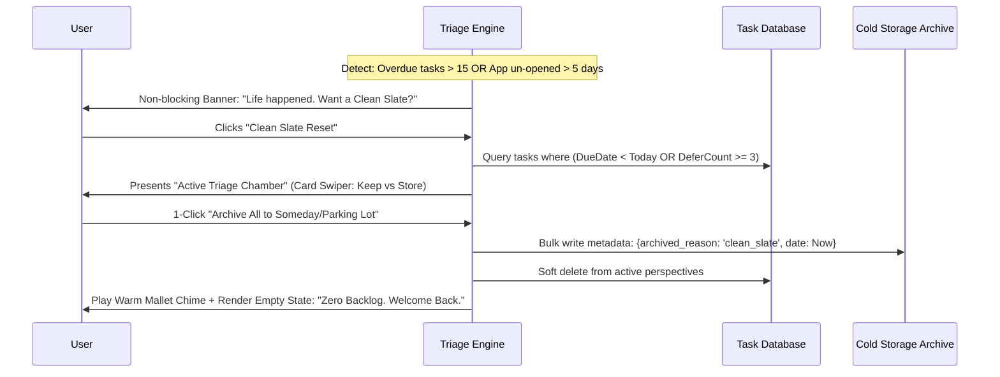

# FlowTask UI/UX Design System & Ergonomic Specification: The 2026 Workstation Standard

**Document ID:** UX-ANALYSIS-R2-COMPREHENSIVE  
**Publication Date:** 25 October 2026  
**Research Series:** Research #2 (Next-Generation Productivity, Planning & Life Systems)  
**Target Purpose:** Deep technical and mathematical visual design specification analyzing layout architecture, pinch/swipe kinematics, acoustic sound design, spring physics, typography, density modes, and workflow state machines across modern category leaders (Superlist, Things 3, Notion Calendar/Cron, Craft, Akiflow, Ellie Planner, Amazing Marvin, BeforeSunset AI).

---

## 1. Ergonomic Layout Architecture & Viewport Paradigms

Modern workstation software relies on a **responsive, tri-pane modular workspace** with contextual slide-out inspectors and floating action HUDs, maintaining optimal visual line-lengths and zero-context-switching workflows.

### 1.1 Desktop Layout Architecture (1280px to 1920px Standard)

```text
┌────────────────────────────────────────────────────────────────────────────────────────┐
│ TOP BAR: Breadcrumbs / Active Context ── Search [Cmd+K] ── Today's Progress Ring ── Sync │
├───────────────┬────────────────────────────────────────┬───────────────────────────────┤
│ LEFT RAIL     │ CENTER ACTION WORKSPACE                │ RIGHT COMPANION / TIME-BLOCK  │
│ (220px–260px) │ (Fluid: 600px–850px)                   │ (320px–420px Collapsible)     │
│ Collapsible   │                                        │                               │
│ [Cmd + \]     │ • Primary View Header (Title, Filter)  │ • Multi-Day Calendar Grid     │
│               │ • Quick Add Input Bar (NLP tokenized)  │   (Google / Outlook / Apple)  │
│ • Inbox (4)   │ • Task / Document Stream               │ • Visual Time-Block Spine     │
│ • Today (8)   │   - Active Task Focus Pill             │ • Magnetic Drag-Drop Slots    │
│ • Upcoming    │   - Deep Work / Morning Section        │ • Staged Brain Dump Shelf     │
│ • Life Areas  │   - Admin / Afternoon Section          │ • Deficit Capacity Meter      │
│   - Career    │   - Evening Routine Check-ins          │   (4.5h committed / 6h max)   │
│   - Health    │                                        │                               │
│   - Finance   │                                        │ [Toggle with 'C' or Button]   │
│ • Projects    │                                        │                               │
│ • Notes Lib   │                                        │                               │
└───────────────┴────────────────────────────────────────┴───────────────────────────────┘
```

#### Layout Rules:
1. **Left Navigation Rail (Fixed 240px, collapsible to 0px via `Cmd + \`):** Dedicated to high-level domain navigation (Inbox, Today, Areas, Projects, Notes).
2. **Center Action Canvas (Fluid, max-width 850px):** Constraining line length to 850px ensures optimal reading ergonomics (60–75 characters per line).
3. **Right Companion Time-Block Grid (Collapsible 360px, toggled with `C` key):** Enables seamless drag-and-drop from the central task stream directly onto hourly calendar slots without switching views.

---

## 2. Interactive Kinematics: Pinch-to-Zoom & Mobile Gesture Systems

### 2.1 Pinch-to-Zoom Timeline Kinematics & Focal-Point Preservation

```
Timeline Pinch-to-Zoom Scale Mapping:
Height / Hour (px)
 240px |------------------------------------- Ultra-Granular (5-min snap, v < 0.1 px/ms)
 160px |----------------------- High Detail (15-min snap default)
  80px |------------ Compact Workday (30-min snap)
  40px |----- Panoramic Day (60-min snap)
       +--------+--------+--------+--------+-> Zoom Factor (s)
      0.5x     1.0x     1.8x     2.5x     3.0x
```

#### Continuous Scale & Dynamic Snapping Rules:
- **Continuous Scale Factor:** $s \in [0.5, 3.0]$.
- **Hour Block Height Mapping:**
  $$H_{\text{hour}}(s) = 80\,\text{px} \times s \implies H \in [40\,\text{px}, 240\,\text{px}]$$
- **Dynamic Snapping Intervals:**
  - $s \in [0.5, 1.0)$: Timeline snaps drops to **60-minute** increments.
  - $s \in [1.0, 1.8)$: Snaps to **30-minute** increments.
  - $s \in [1.8, 2.5)$: Snaps to **15-minute** increments (Standard default).
  - $s \in [2.5, 3.0]$: Snaps to **5-minute** micro-increments (activated only when drag velocity $|v| < 0.1\,\text{px/ms}$).
- **Focal-Point Preservation Formula:**
  The temporal coordinate under the two pinch touch centers $(y_{\text{touch1}} + y_{\text{touch2}})/2$ must remain static in viewport space during scale transformation:
  $$Y_{\text{scroll\_new}} = Y_{\text{focal\_time}} \times H_{\text{hour}}(s_{\text{new}}) - y_{\text{viewport\_center}}$$

---

### 2.2 Mobile Swipe Kinematic Resistance & Haptic Map

Horizontal task row swipe physics (Right = Complete/Archive, Left = Defer/Delete):

| Swipe Zone | Displacement ($\Delta x$) | Resistance Factor ($k_{\text{drag}}$) | Action Triggered | Haptic Feedback Pattern |
| :--- | :--- | :--- | :--- | :--- |
| **Zone 0: Deadband** | $0 \le |\Delta x| < 24\,\text{px}$ | $0.20$ (High resistance) | None (Cancels on release) | None |
| **Zone 1: Elastic Cue**| $24 \le |\Delta x| < 80\,\text{px}$ | $0.65$ (Rubber-band) | Visual background icon reveals | None |
| **Zone 2: Primary Action**| $80 \le |\Delta x| < 180\,\text{px}$ | $1.00$ (Direct tracking) | Right: Complete / Left: Defer | `UIImpactFeedbackGenerator(style: .medium)` (fires at exactly $80\,\text{px}$) |
| **Zone 3: Destructive** | $|\Delta x| \ge 180\,\text{px}$ | $0.45$ (Fluid pull) | Right: Deep Archive / Left: Hard Delete | `UINotificationFeedbackGenerator(.warning)` (fires at $180\,\text{px}$) |

* **Velocity Fling Override:** If release velocity $|v_x| \ge 750\,\text{px/s}$, execute the Zone 2 action immediately, bypassing the distance threshold requirement.

---

## 3. Acoustic Earcon Engineering Specs & Sound Design

Auditory feedback must avoid high-frequency ear fatigue ($2.5\,\text{kHz} - 4.0\,\text{kHz}$ resonance peaks) while delivering satisfying dopamine reinforcement.

```
ADSR Envelope Topology for Task Completion Chime:
Amplitude
  1.0 |   /\
      |  /  \
      | /    \_______ (Sustain: -16dB @ 0.158)
  0.0 |/_____________\______
       |A | D |   S   |  R  |
       0  3  68      140   420 ms
```

### 3.1 Task Complete Earcon (Pentatonic FM Sparkle)
- **Musical Pitch Sequence:** Ascending Four-Note Arpeggio ($E_5 \to G\#_5 \to B_5 \to E_6$).
  - $f_1 = 659.25\,\text{Hz}, f_2 = 830.61\,\text{Hz}, f_3 = 987.77\,\text{Hz}, f_4 = 1318.51\,\text{Hz}$.
  - Note staggering: Note delay $\Delta t = 38\,\text{ms}$ between pitches.
- **Synthesizer Engine:** 2-Operator Frequency Modulation (FM).
  - Carrier: Sine Wave ($f_c$).
  - Modulator: Sine Wave ($f_m = 2 \times f_c$).
  - Modulation Index ($\beta$): Starts at $\beta = 1.2$ at $t = 0$, decaying exponentially to $\beta = 0.05$ over $60\,\text{ms}$ to yield an initial crystalline chime that settles into a pure tone.
- **ADSR Envelope:**
  - Attack: $3\,\text{ms}$ (instant transient click).
  - Decay: $65\,\text{ms}$.
  - Sustain Level: $-16\,\text{dB}$ ($0.158$).
  - Release: $280\,\text{ms}$ (exponential decay tail).
- **Filtering & Output:**
  - Low-Pass Filter: 2-Pole State-Variable Filter (Cutoff: $5.4\,\text{kHz}$, $Q = 0.707$).
  - Notch Filter: Fixed notch at $3.2\,\text{kHz}$ ($-6\,\text{dB}$) to eliminate harsh piercing overtones.
  - Master Level: Calibrated to $-18\,\text{LUFS}$.

### 3.2 Task Defer / Reschedule Earcon (Soft Felt Woodblock Chime)
- **Acoustic Character:** Warm, reassuring, neutral tone; non-punitive.
- **Musical Pitch Sequence:** Descending Minor Third ($D_5 \to B_4$).
  - $f_1 = 587.33\,\text{Hz}, f_2 = 493.88\,\text{Hz}$. Note delay $\Delta t = 55\,\text{ms}$.
- **Synthesizer Engine:** Physical Modeling Mallet / Bandpass Filtered Triangle.
- **ADSR Envelope:**
  - Attack: $16\,\text{ms}$ (soft felt mallet strike).
  - Decay: $110\,\text{ms}$.
  - Sustain Level: $0.00$ ($-\infty\,\text{dB}$).
  - Release: $140\,\text{ms}$.
- **Filtering:** Bandpass Filter centered at $750\,\text{Hz}$ ($Q = 1.4$). Master Level: $-21\,\text{LUFS}$.

### 3.3 Focus Timer Start & State Transition Earcons
- **Timer Ignition:** Single resonant Tibetan Sing-Bowl tone ($F\#_4$, $369.99\,\text{Hz}$) with slow attack ($40\,\text{ms}$) and long resonant modal tail ($\tau = 2.4\,\text{s}$).

---

## 4. Damped Harmonic Oscillator Spring Physics & Density Scale

All dynamic UI transitions use damped harmonic oscillators rather than cubic-bezier curves:
$$m \frac{d^2x}{dt^2} + c \frac{dx}{dt} + kx = 0 \implies \zeta = \frac{c}{2\sqrt{km}}, \quad \omega_n = \sqrt{\frac{k}{m}}$$

```
Displacement x(t) Response Curves:
x(t)
 1.2 |      _--_ (Underdamped ζ = 0.82: Snappy Card Lift)
 1.0 |---- /----\================ (Critically Damped ζ = 1.0: Precise Grid Snap)
     |    /
     |   /
 0.0 +--+-----------------------> Time (ms)
     0 50 100 150 200 250
```

### 4.1 Spring Physics Token Library

| Interaction Type | Mass ($m$) | Stiffness ($k$) | Damping ($c$) | Damping Ratio ($\zeta$) | Settling Time ($t_s$) | Perceptual Character |
| :--- | :--- | :--- | :--- | :--- | :--- | :--- |
| **Card Lift (Drag Start)** | $1.0\,\text{kg}$ | $360\,\text{N/m}$ | $31.0\,\text{Ns/m}$ | $\mathbf{0.817}$ (Slight overshoot) | $165\,\text{ms}$ | Snappy, tactile, connects immediately to pointer |
| **Timeline Snap (Drop)** | $1.0\,\text{kg}$ | $280\,\text{N/m}$ | $33.46\,\text{Ns/m}$| $\mathbf{1.000}$ (Critically damped) | $180\,\text{ms}$ | Zero bounce, authoritative lock into calendar slot |
| **Modal Quick-Add Sheet** | $1.2\,\text{kg}$ | $440\,\text{N/m}$ | $38.50\,\text{Ns/m}$| $\mathbf{0.838}$ (Micro-rebound) | $210\,\text{ms}$ | Natural sheet sliding in from bottom edge |
| **Adjacent Item Reflow** | $0.8\,\text{kg}$ | $310\,\text{N/m}$ | $31.48\,\text{Ns/m}$| $\mathbf{1.000}$ (Critically damped) | $145\,\text{ms}$ | Smooth lateral opening of whitespace on timeline |

---

### 4.2 Three-Tier Density Specification

| Token / Spec | Compact (Power GTD / Multi-Window) | Default (Standard Planning) | Spacious / Focus (ADHD / Touch) |
| :--- | :--- | :--- | :--- |
| **Row Height** | $28\,\text{px}$ | $38\,\text{px}$ | $52\,\text{px}$ |
| **Primary Typography** | $12\,\text{px}$ (Inter Medium, line: $16\,\text{px}$) | $14\,\text{px}$ (Inter Regular, line: $20\,\text{px}$) | $16\,\text{px}$ (Inter Regular, line: $24\,\text{px}$) |
| **Metadata Font** | $10\,\text{px}$ (SF Mono, line: $12\,\text{px}$) | $12\,\text{px}$ (Inter, line: $16\,\text{px}$) | $13\,\text{px}$ (Inter, line: $18\,\text{px}$) |
| **Vertical / Horiz Padding**| $4\,\text{px} \times 8\,\text{px}$ | $8\,\text{px} \times 12\,\text{px}$ | $14\,\text{px} \times 16\,\text{px}$ |
| **Checkbox / Tap Target** | $14\,\text{px}$ checkbox ($28 \times 28\,\text{px}$ target) | $18\,\text{px}$ checkbox ($38 \times 38\,\text{px}$ target) | $22\,\text{px}$ checkbox ($48 \times 48\,\text{pt}$ target) |
| **Corner Radius ($R_c$)** | $4\,\text{px}$ | $8\,\text{px}$ | $12\,\text{px}$ |
| **Target Hardware** | Desktop multi-window / Mac 27" | Laptop 14" / iPad landscape | Mobile (iOS/Android) / Focus tablet |

---

## 5. Precision Triage Workflows: State Machines & Blueprints

### 5.1 Workflow 1: The 'Clean Slate' Backlog Quarantine & Opacity Decay

To eliminate the catastrophic churn caused by overdue task accumulation, FlowTask runs an automated **Backlog Quarantine & Opacity Decay Engine**:



#### Visual Opacity Decay Algorithm:
Instead of aggressive red badges, deferred tasks undergo CSS color desaturation and opacity decay over time:
$$\text{Opacity}(\text{task}) = \max\left(0.40, \; 1.0 - 0.12 \times \text{DeferCount}\right)$$
When a task reaches $0.40$ opacity, a subtle contextual pill appears: *"Let this go?"* prompting 1-tap painless archiving.

---

### 5.2 Workflow 2: Brain Dump to Magnetic Grid Staging Pipeline

```text
+--------------------------------------------------------------------------+
| BRAIN DUMP STAGING INBOX                 | TODAY'S 24-HOUR TIMELINE      |
|                                          |                               |
| [Textarea: "Draft slide deck ~45m #q3"]   | 09:00 [ Team Standup (Cal)  ] |
|                                          | 09:30                         |
| Generated Chips:                         | 10:00 +---------------------+ |
| +--------------------------------------+ |       | MAGNETIC DROP ZONE  | |
| | Draft slide deck [45m] [#q3] [P1]    | |       | 10:00 - 10:45       | |
| +--------------------------------------+ |       | Draft slide deck    | |
|   |                                      |       +---------------------+ |
|   +-- (Dragging across divide) --------> | 11:00                         |
|                                          | 11:30 [ Customer Call (Cal) ] |
| Capacity Meter: [■■■■■■■■□□] 4.5/6.0h    | 12:00                         |
+--------------------------------------------------------------------------+
```

1. **Unstructured Stream Capture:** Accepts raw text or Whisper audio.
2. **Client-Side Regex / NLP Tokenizer:**
   - Duration tokens: `~45m`, `1.5h` $\to$ maps to `duration_seconds: 2700`.
   - Temporal anchors: `@2pm`, `@tomorrow` $\to$ maps to `scheduled_start`.
   - Tags & Priority: `#project`, `!p1` $\to$ maps to tags and priority schema.
3. **Staging Shelf (Unscheduled Chips):** Parsed items sit in a horizontal queue ordered by estimated cognitive load.
4. **Magnetic Drag-and-Dock:** Dragging an item across the timeline boundary triggers a snap preview inside detected calendar gaps. Gaps smaller than task duration turn red with an auto-split prompt ("*Split into 20m + 25m chunks?*").
5. **Real-time Capacity Meter:** Top status bar dynamically increments committed time against the workday limit ($T_{\text{scheduled}} / T_{\text{available}}$).

---

### 5.3 Workflow 3: GTD Guided 5-Stage Weekly Review Engine

```text
Stage 1: Clear Inboxes (Zero out digital capture, emails, voice notes)
   ↓ [Shortcut: 'E' Archive | 'T' Convert to Action | 'D' Delete]
Stage 2: Project Calibration (Loop through active projects)
   ↓ [Validation Rule: Every active project MUST have >= 1 Available Action]
Stage 3: Waiting-For Audit (Review delegated tasks & external dependencies)
   ↓ [Action: Send 1-click ping nudge or mark completed]
Stage 4: Someday / Maybe Incubation (Promote dormant ideas to active projects)
   ↓ [Action: Move to Active Next Week OR Keep Sleeping]
Stage 5: Weekly Horizon Commit (Lock the upcoming weekly focus themes)
```

- **Keyboard Review Ergonomics:**
  - `j` / `k`: Previous / Next project.
  - `Space`: Mark project reviewed and advance to next.
  - `n`: Create new child action under active project.
  - `p`: Pause review and save state.
- **Progress Tracking:** Displays a real-time progress indicator (`Project 8 of 14 • 57% Done`) and celebrates completion with an ambient soundscape and summary report ready for export.
