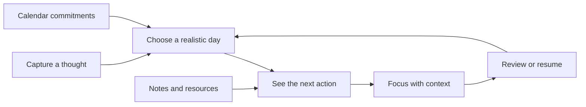
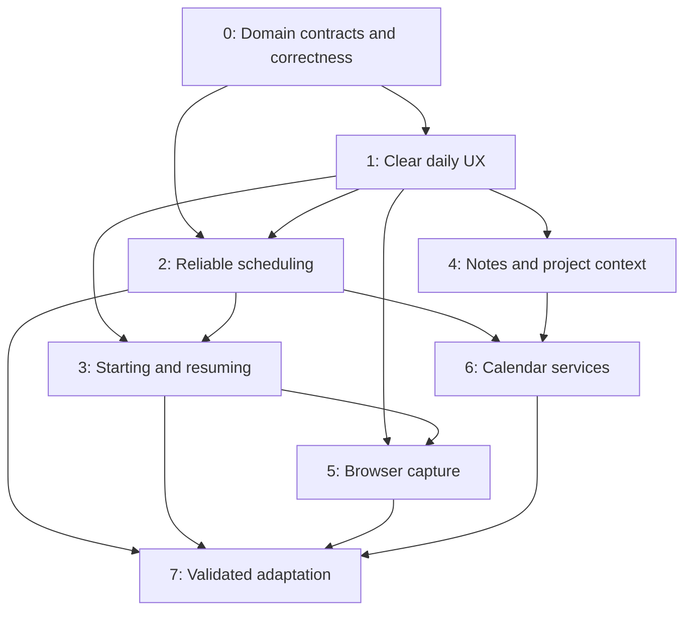

# Phased implementation plan

25 October 2026 · Proposed work, not an implementation-complete claim.

Read with [current gaps/design](FLOWTASK_GAPS_AND_DESIGN.md) and [33 competitor profiles](COMPETITOR_ANALYSIS.md). Gap IDs G01–G30 and journeys J1–J6 are defined in the design document. This plan supersedes earlier recommendations only where current source/evidence is explicitly rechecked; it does not discard implemented work.

## 1. Product outcome and delivery strategy

Deliver a complete personal execution loop:



Use three release increments:

1. **Daily-use release:** phases 0–1. Correct shared rules and improve readable, responsive capture/Today/task editing. This is the highest-priority result.
2. **Connected execution release:** phases 2–5. Reliable calendar interaction, initiation support, notes/project continuity and browser capture. Release bounded slices as they pass their gates.
3. **Connected calendar and adaptive release:** phases 6–7. Add provider capabilities and validated planning improvements without making offline core work dependent on them.

Do not make all eight phases a prerequisite for shipping the first improvement. Do not bundle every experimental feature into public scope.

### Capacity assumptions and estimate meaning

Effort is estimated in **engineer-weeks**, including implementation and directly related automated validation. Estimates assume familiarity with this React/TypeScript/Zustand/IndexedDB/Firebase codebase. They exclude a new native app, paid media licensing, video marketplace, full document-editor replacement and enterprise scheduling.

| Phase | Effort | Main owner role | Dependency |
|---|---:|---|---|
| 0 | 1–2 | Domain/platform engineer with product/design | Starts first |
| 1 | 2–3 | Frontend/product engineer with design/QA | Domain decisions in 0 |
| 2 | 3–5 | Domain + frontend | 0; shared UI primitives from 1 |
| 3 | 2–4 | Frontend/domain | 0–1; time helpers from 2 |
| 4 | 2–4 | Frontend/domain | 0–1; context links can overlap 3 |
| 5 | 2–4 | Extension/platform | 0, capture contract from 1; timer contract from 3 |
| 6 | 4–7 | Platform/backend + calendar frontend | 2; event context extension depends on 4 |
| 7 | 3–5 | Domain/product + audio as needed | 2–6 and actual user evidence |
| **Total** | **19–34** | | |

Add **20–30% contingency** after estimating the actual backlog. Two engineers with part-time design and QA support might deliver over **14–24 elapsed weeks**, with selected overlap and beta observation. This is a provisional staffing scenario, not a commitment. Provider approval, credentials and physical-device testing can extend calendar time even when engineering work is complete. One engineer should plan much closer to the sum of effort plus contingency.

Re-estimate after phase 0, after the first scheduling slice and after the provider spike. Record actual work rather than compressing unresolved scope into the lower bound.

## 2. Architecture contracts to agree before expansion

### A. Commands and save semantics

Continue using `WorkspaceStore.run` and existing command/inverse/outbox infrastructure. UI components request domain operations; they do not independently decide schedule validity, eligibility or recurrence behavior. Local persistence precedes confirmed success. Cloud-delivery status remains separate from local-save status.

Every new persisted entity/field needs: type, validation, migration/default, serialization, allowed clears, Firestore rules, sync ownership, conflict behavior, export/restore, recovery, relationship cleanup and Undo treatment. Feature flags hide UI, not the ability to read existing saved data. Never remove fields to make a rejected write appear successful.

### B. Task eligibility

Consolidate the existing predicates into a single API, with adapters for old callers during migration:

```ts
type Eligibility = {
  actionable: boolean;
  reason?: 'completed' | 'archived' | 'deleted' | 'someday'
    | 'deferred' | 'dependency' | 'project_paused';
  blockerIds?: string[];
  availableAt?: number;
};

// Proposed contract; naming can follow the existing module conventions.
getTaskEligibility(task, { tasksById, projectsById, now, timezone }): Eligibility;
```

Use explicit project task order for sequential projects. Reject cycles and impossible self-dependencies. Specify how archived/deleted/missing predecessors behave; do not silently invent the same answer in separate selectors. Due-soon and overdue views can include unavailable work with a reason, without making it actionable. Search should be able to find deferred work.

Pass a clock into pure functions; do not compare one date argument against `Date.now()` elsewhere. A date-only defer value means the start of that date in its defined workspace zone, not midnight UTC by accident.

### C. Time and scheduled work

Retain task planned day and actual deadline as task intentions. Use workspace-level `WorkBlock` records as the proposed authoritative representation of scheduled work after migration. Components derive views by `taskId`. Embedded task blocks and legacy clock fields become temporary compatibility projections with a removal plan, rather than independently editable records.

Store UTC instants plus the IANA zone that explains the user's scheduling intent. Keep all-day events as date ranges, not invented timed meetings. Resolve wall time in the chosen zone through a tested time layer; use the existing stack where correct, or select a timezone dependency only after a bounded compatibility/bundle spike. Do not rely on native parsing of arbitrary local strings.

Migration must be idempotent and conservative. Existing records may contain inconsistent instants and wall labels. Snapshot first; classify records; preserve their original values. Only auto-convert records with an unambiguous interpretation. Ambiguous blocks require a visible repair state with proposed local times. Do not globally add/subtract a fixed offset or silently move past work.

### D. Scheduling proposal and commit

Retain and extend `createSchedulePreview` and its fingerprint protection. Shared services should produce a proposal with placements, unchanged/locked blocks, unplaced tasks, reason codes, input version and calendar freshness. Applying a stale proposal recomputes and asks the user to review the changed proposal; it must not silently apply different placements.

Hard constraints: task eligibility, fixed busy events, locked work, work-window boundaries, block validity and explicit deadlines. Soft preferences: energy windows, category grouping, fewer gaps and less movement. Explainable earliest-fit behavior is sufficient for the first release. Later optimization must not claim mathematical infeasibility merely because a heuristic failed to place a task.

Manual drop, time form, keyboard move, resize, scheduling preview and assistant tools call the same schedule validator/commit path. “Allow overlap” is an explicit user choice, if supported. It does not override a task lock or rewrite an external meeting.

### E. Capacity and forecast vocabulary

Freeze these concepts in a short architecture decision, preserving or migrating current settings semantics explicitly:

| Value | Meaning |
|---|---|
| Daily budget | Configured daily usable minutes; document whether it currently includes meetings |
| Calendar commitments | Union of busy intervals within the configured window; duplicates/overlaps count once |
| Task allowance | Daily budget minus commitments under the chosen budget semantics |
| Recorded task work | Actual valid task-work minutes already logged; not a second estimate |
| Remaining allowance | Task allowance less recorded task work, bounded at zero |
| Free future intervals | Wall-clock gaps after now, minus future meetings, fixed work and required buffers |
| Room for additional work | Minimum of remaining unallocated allowance and free future intervals |
| Remaining demand | Effective unfinished task estimates; count work once across parent/subtasks/blocks |
| Continuous-work finish | Now plus queue remaining work/breaks, ignoring external interruptions, labeled as such |
| Calendar-aware finish | Placement-based forecast accounting for known busy intervals and constraints |

A UI can show six-hour daily capacity while only 40 minutes of today's open calendar remain; it must label both correctly. Allocate scheduled future work once when calculating space for additional work. Never subtract a block duration and the same logged minutes twice. Unknown estimates and stale calendar inputs stay visible.

### F. One focus lifecycle

Keep existing session IDs, checkpoints and focus logs authoritative. Task editor, Studio, HUD, mini-player and extension observe that session. They must not each decrement and save independent timer state. Derive elapsed/remaining time from timestamps and accumulated pauses; reconcile after sleep/reload.

Finish/log operations use a stable session identity and reject stale updates, so retries do not create duplicate logs. Timer completion, task completion and routine-step completion remain separate events. Preserve device-local queue preferences unless a deliberate sync contract is added; do not start syncing currently excluded private playback state by accident.

### G. Context and provenance

Use stable IDs for note/task/project/resource references. Imported calendar context uses provider + connection + calendar + event/occurrence identity; a recurring series ID alone is insufficient for a meeting note.

An extracted task links back to the original note and excerpt. Repeating extraction should either reuse the existing relation or explicitly create another task. Deleting a source does not destroy independently valuable notes, work logs or local tasks.

## 3. Phase 0 — establish correctness and a current baseline

**Goal:** agree on the behavior every later feature depends on and close reproducible source risks. **Scope:** G01–G05. **Effort:** 1–2 engineer-weeks. Larger data repair or backend issues discovered here trigger re-estimation.

| Package | Work and implementation anchors | Acceptance |
|---|---|---|
| P0-01 Baseline inventory | Snapshot current commit/working-tree state and supported entities. Reconcile old audits with current source. Read `UX_SIMPLIFICATION`, production readiness and current tests. Preserve unrelated changes. | Capability ledger identifies present/partial/missing/gated; no old fixed issue reintroduced as new work. |
| P0-02 Eligibility | Consolidate `taskSelectors`, `workspaceSelectors`, dependency helpers and planner candidate selection; choose dependency-order policy. | A deferred, blocked, someday or completed task has the same actionability across Today, Focus, Plan and counts; search can find it with a reason. |
| P0-03 Time conversion | Reproduce local-to-instant mismatch in `workBlockService`; add shared zone conversion and formatting helpers. Identify affected persisted forms/callers. | 09:00 Asia/Kolkata is 03:30Z; UTC and half-hour zones work; daylight-saving gap/fold behavior is specified and tested. |
| P0-04 Canonical schedule decision | Document migration from legacy schedule fields/embedded blocks to workspace blocks, ownership, conflict behavior and compatibility period. | One clear source of truth; idempotent migration fixtures; ambiguous records preserved for repair; no automatic bulk time shift. |
| P0-05 Safety and measurement baseline | Run relevant current checks on Node 22 and record production-build journeys, storage round trips, capture latency and representative screen geometry. | Evidence belongs to the current candidate; failures have owner/severity; unknown live/device checks remain explicitly open. |

**Meaningful tests:** pure eligibility table with explicit clock, mixed legacy block migrations, task/subtask estimate accounting, workspace export/restore with all supported entities, and two-way relationship integrity. Validate an actual sequence of operations and reload, not merely component rendering.

**Exit gate:** G01/G02 are resolved for supported operations, schedule migration/validation contracts are accepted, and any continuing release blockers are identified. Do not proceed with new scheduling automation while these contracts remain contradictory. UI design and nondependent layout work may proceed against saved fixtures.

## 4. Phase 1 — make the daily workflow clear

**Goal:** reduce reading and decision cost using the features already present. **Scope:** G06–G11, G19, G28 capability messaging. **Effort:** 2–3 engineer-weeks.

| Package | Work and implementation anchors | Acceptance |
|---|---|---|
| P1-01 Shared shell and tokens | Consolidate page headers, action hierarchy, task-row surfaces, spacing and empty states. Keep current themes/preferences. Touch `AppShell`, `Sidebar`, `DesktopHeader`, shared UI and component-owned styles. | Representative light/dark/image themes have readable text; keyboard focus and target sizing checked; existing URLs and navigation preserved. |
| P1-02 Today layout | Refine `HorizonTodayView`, timeline companion and Today appearance. Compact phone header, put resume/next action early, move customization to secondary access. | At 390px, representative first task/resume action is visible within target geometry; no hidden bottom actions or horizontal overflow at 320px. |
| P1-03 Explicit placement semantics | Replace morning/deep-work inference conflicts with explicit schedule/Evening precedence. | A 15:00 deep task is never shown as a morning commitment; explicit Evening survives reload and does not change deadline. |
| P1-04 Task drawer disclosure | Group secondary properties, make the next action and duration easy to edit, isolate optional study fields. Use shared dialog/drawer behavior. | Keyboard users can create, schedule, edit, clear fields and return to the originating row; failed saves preserve input. |
| P1-05 Capture parity | Route composer, HUD, Brain Dump and later extension intents through canonical creation semantics; retain token preview and override precedence. | Same text/settings yields matching fields across surfaces; explicit overrides win; disabled parsing stays disabled; no forced deadline. |
| P1-06 Ritual continuity | Refine existing planning steps to filter eligible candidates, review unfinished work and recover a dated draft. Keep title-only capture and skip route. | Cancel creates no unintended tasks/plan mutations; resume restores choices; final apply is one reversible operation. |
| P1-07 Reminder clarity | State supported delivery in Settings and creation UI; keep permissions contextual; show denied/unavailable state. | The product does not promise delivery while closed unless that path exists; permission refusal does not block task creation. |

**Validation:** J1 and the planning portion of J2; real keyboard journey, long titles, empty/heavy states, 200% zoom, narrow phone layout and simulated virtual-keyboard viewport. Run targeted regression scenarios, then required repository verification for the release candidate.

**Exit gate:** a new user can capture, choose a day and start work without opening customization or advanced configuration. Proposed usability target: at least 5 of 6 moderated participants complete the core journey unaided; failures are observed and prioritized, not hidden in average scores. Include people with different planning habits; do not generalize this small sample to clinical outcomes.

## 5. Phase 2 — dependable timeblocking

**Goal:** make every planning surface agree on the same task, time and constraints. **Scope:** G03/G04, G11–G14. **Effort:** 3–5 engineer-weeks. **Depends on:** phase 0 contracts and phase 1 primitives.

| Package | Work and implementation anchors | Acceptance |
|---|---|---|
| P2-01 Work-block migration | Implement the approved block migration, selectors and compatibility projections in `dbService`, validators, store and backup/sync paths. | A task with multiple valid blocks renders each once; old one-block tasks retain intent; round-trip and interrupted migration are safe. |
| P2-02 Schedule commands | Add/reuse create/move/resize/remove/lock domain operations in `workBlockService` and planner service. All manual/assistant entry points call them. | Identical commands enforce bounds/locks/busy events/dependencies identically; one durable commit and Undo per completed gesture. |
| P2-03 Range/calendar state | Own date/range in one parent model; cache parsed feed ranges by source/version; load visible days, recurring exceptions and overnight events. | Navigating 1/3/7 days keeps header/events/capacity aligned; stale sources have visible state; hidden events do not disappear from availability accidentally. |
| P2-04 Grid and mobile agenda | Refine existing canvas/grid: overlap lanes, ghost labels, drag cancel, edge-scroll, time form and keyboard movement. Make phone staging a drawer. | J2 can be completed with keyboard and touch without dragging; no unusable narrow grid; zoom preserves time anchor. |
| P2-05 Capacity vocabulary | Implement contract E once; reuse in Today, Plan, Upcoming, planning wizard and assistant summary. | Meetings count by interval union; parent/subtasks/logged time are not double-counted; late-day free time and daily budget are distinguished. |
| P2-06 Preview improvements | Explain placement and exclusion, show input freshness and exact diff; introduce multiday planning behind a flag after day parity. | Locks remain fixed; future-only placement; changed inputs invalidate preview; unscheduled tasks explain missing estimate/gap/dependency/deadline constraint. |

**Algorithm sequence:** normalize inputs → compute eligibility → subtract merged busy intervals → reserve fixed work/buffers → order flexible candidates deterministically → propose placements → return reasons/unplaced work → validate again against current revision → apply one batch. Start with existing earliest-fit logic and stable ordering. Benchmark realistic task/calendar sizes before adding a worker or optimizer.

**Boundary:** initial week proposals may be heuristic and preserve existing committed work. Cross-week optimization, team workloads and autonomous provider writes are not phase-2 requirements.

**Tests:** collisions, DST, all-day exclusive-end dates, midnight crossing, overlapping events, missing durations, split task accounting, cancelled blocks, stale previews, drag cancel, time-form parity, Undo after a later unrelated edit, and migrations through reload/export. Use existing `CalendarTimeGrid`, timeline and schedule test suites as starting points.

**Exit gate:** J2 and J4 complete with consistent visible results across Today/Plan/Focus. No silent lock/deadline changes, invalid time blocks or unexplained discrepancy in remaining work. Keep the multiday flag off if day parity or migration is incomplete.

## 6. Phase 3 — make starting and resuming easier

**Goal:** refine execution support instead of adding another timer. **Scope:** G15–G19, G29 estimate foundations. **Effort:** 2–4 engineer-weeks.

| Package | Work and implementation anchors | Acceptance |
|---|---|---|
| P3-01 Breakdown proposals | Reuse the concurrently added `GranularitySliderPopover` and `aiCopilot.decomposeTask`; join them with starter-step helpers, drawer and Copilot. Refine editable proposals, selected-step regeneration and preserved edits. Validate the new row integration before relying on it. | Everyday tasks produce useful editable suggestions; retry never duplicates steps; adding subtasks does not add parent duration twice. |
| P3-02 Now/Next queue | Refine Studio/HUD and focus launchpad with a small manually chosen queue, remaining-work display and labeled horizon. | Queue reordering does not alter deadlines; completed/unavailable tasks are handled visibly; simple and calendar-aware finish times are not conflated. |
| P3-03 Small-start mode | Reuse current lifecycle for a 5/10-minute attempt, with next action, pause, extend and return. | Temporary timebox does not overwrite the underlying task estimate; timer end does not complete task; one session/log across presentations. |
| P3-04 Routine recovery | Audit existing timestamp recovery, resume/restart behavior, workspace scoping, step skips and completion records. Unify common timer mechanics where needed. | Sleep, refresh, step advance and account switch do not leak state, duplicate a run or erase completed work. |
| P3-05 Gentle return | Refine Clean Slate/review; expose unfinished work and real deadline risk without opacity decay or guilt-heavy default messaging. | Bulk replan/archive is explicit and reversible; overdue deadlines remain discoverable; legitimate interruptions retain work logs. |
| P3-06 Estimation evidence | Capture suitable estimate snapshots/outcome metadata using current logs; distinguish partial/interrupted work from completed-duration samples. | Estimates do not change automatically; sample count/scope visible; unknown data is excluded rather than treated as zero. |

**Horizon behavior:** recalculates when estimates, queue, pauses or busy intervals change. Do not shift the visible queue every second. Use the existing remaining-work calculation; present overtime neutrally and offer a new plan, not an accumulating overdue alarm.

**Tests:** J3, J4, timer reload/sleep, two surfaces finishing the same session, missing/deleted queue task, repeated proposal submission, routine already finished on another surface and restoration in another workspace.

**Exit gate:** users can start a small action, recover from interruption and understand what happens next. No duplicate task work or second timer state machine. Routine and task execution remain distinguishable.

## 7. Phase 4 — preserve context across notes and projects

**Goal:** make existing knowledge useful at execution time. **Scope:** G20–G22. **Effort:** 2–4 engineer-weeks.

| Package | Work and implementation anchors | Acceptance |
|---|---|---|
| P4-01 Note-to-task interaction | Extend Notes editor, `notesService`, `noteModel` and existing linked-task relations with selection preview and live task cards. | A selected action creates one canonical task, backlinks survive rename and retry is safe; archived/deleted source has a useful fallback. |
| P4-02 Lightweight templates | Add optional meeting/reference/project templates and saved defaults; introduce only validated metadata needed for retrieval. | Capture can remain untyped; existing Markdown and exports remain readable; no arbitrary schema-builder dependency. |
| P4-03 Project resume | Join existing notes/resources/milestones/recipes into a resume card and context panel in project/focus views. | User can identify the next available action and open relevant context with one or two actions. Associations use IDs, not title/ID substring guesses. |
| P4-04 Event-note foundation | Define stable event-occurrence reference and local note survival policy; support imported/local event context before provider linking. | Reopening the same occurrence reuses its note; rescheduled event updates the reference; removing an event does not delete notes. |
| P4-05 Retrieval | Refine current search ranking and filters for tasks/notes/resources; show type, project and relevant excerpt. | Find a source note by task wording and find the task from the note; deferred/archived filters are explicit. |

**Boundary:** full rich-block editing, deep nested documents, graphs and custom object schemas are excluded. Reassess only if users cannot retrieve context with these simpler improvements.

**Tests:** J5; links across rename/archive/trash/restore, repeated extraction, project deletion/reassignment, imported Markdown with links, note version recovery and export/restore.

**Exit gate:** planning and focusing no longer require reconstructing notes/resources by manually searching several screens. Measure resumption task success, not the number of backlink edges.

## 8. Phase 5 — dependable browser capture and focus visibility

**Goal:** extend the existing MV3 extension into a reliable companion. **Scope:** G23–G25; optional new-tab experiment only after these pass. **Effort:** 2–4 engineer-weeks.

| Package | Work and implementation anchors | Acceptance |
|---|---|---|
| P5-01 Capture protocol | Refine `extension/` with versioned capture intents, request IDs, source metadata, explicit target origin/workspace and saved acknowledgment. Persist pending intents in extension storage. | App unavailable means queued, not “saved”; retry dedupes; wrong origin/account cannot receive data; data survives worker restart. |
| P5-02 Focus projection | Add a narrow session bridge and toolbar badge/tooltip/popup. App lifecycle stays authoritative; extension caches only permitted projection. | Same session after tab changes/sleep; no duplicate completion; stale revisions rejected; account switch clears prior details. |
| P5-03 Alarms and wake handling | Use `chrome.alarms` for transition wakeups, plus startup reconciliation from timestamps. Avoid assuming alarms fire on an exact second. | Correct state after delayed wake; badge is repaired from current session; no claim of a continuously running extension worker. |
| P5-04 Resource bundles | Explicit selection and preview of tabs/resources to save; project assignment; controlled open action. | Saved URLs/title/context restore once; unsaved page state is not promised; no default tab closing or suspension. |
| P5-05 Packaging and help | Update manifest, permissions, origin settings, extension README and real install instructions; test Chrome/Edge. | Correct current paths; denied optional permissions remain recoverable; extension packaging/store-review work is documented. |

Security/UX boundary: a normal PWA cannot read arbitrary tabs, block the browser or register a true operating-system-wide capture hotkey. Only request extension permissions needed for enabled behavior. Keep the existing title/URL popup useful if users decline broader capability.

Use a validated origin-bound bridge; validate messages as untrusted input. Never accept a sender-supplied workspace/account identity without checking the bound app state. Acknowledgment means durable save to the intended workspace, not merely that a URL was opened.

**Tests:** J1 failure/retry paths, J6, browser restart, app closed, worker suspended, two app tabs, old message revision, denied host permission, changed target origin, logout and account switch. Add real extension browser checks; ordinary app-unit tests cannot establish extension behavior.

**Exit gate:** capture is trustworthy and focus visibility stays consistent across surfaces. Optional new-tab mode may ship separately after preference testing; it must not load the full private planner automatically.

## 9. Phase 6 — calendars and notifications as maintained services

**Goal:** add real provider connectivity with clear ownership and failure behavior. **Scope:** G21 integration, G26–G28. **Effort:** 4–7 engineer-weeks for the bounded Google-first sequence. Outlook, CalDAV and public bookings require their own follow-on estimates.

### 6A. Read-only Google Calendar slice

1. Spike scopes, consent setup, authentication ownership, token storage, API quota and deployment requirements. Keep provider tokens out of client workspace JSON, browser diagnostics and exports.
2. Add connection/calendar selection, separate display versus availability inclusion, source color, health, last successful refresh and disconnect.
3. Implement initial and incremental sync, pagination, deletions, recurrence exceptions and expired-token/full-resync recovery. Watch notifications trigger fetch/reconciliation; they are not a complete event payload. Renew expiring watch channels.
4. Normalize provider data into cached calendar records and busy intervals. Keep `.ics` import useful without OAuth. Offline uses last known data with freshness disclosure.
5. Connect event context to the phase-4 occurrence note; keep task extraction explicit.

Official implementation references: [Google incremental sync](https://developers.google.com/workspace/calendar/api/guides/sync), [change notifications](https://developers.google.com/workspace/calendar/api/guides/push).

### 6B. Controlled calendar writes

Add “Publish this block to calendar” before broad bidirectional automation. Record provider event mapping and write ownership. Use idempotent retry/reconciliation; resolve competing provider edits instead of duplicating events or overwriting them silently. Reuse the existing outbox pattern where applicable, with server-side token handling and provider-specific adapters.

When a provider write fails, retain the local plan and show the failed external action with retry or disconnect. Local Undo can reverse app-owned calendar events through a compensating operation; it cannot promise instantaneous reversal of an already changed external system. Never delete unrelated provider events.

### 6C. Privacy and reminder delivery

Separate three options:

- **Local display masking:** hides titles on this screen, without altering provider sharing permissions.
- **Private event visibility:** provider-supported event privacy on a selected calendar.
- **Busy mirror:** app-created sanitized event in another account; its record contains no original title, attendees, location, description or private source URL.

Busy mirrors need update/delete reconciliation, loop prevention and origin mapping. Disconnect explains what happens to app-owned mirror events. Do not enable cross-account writes simply because the user connected a read-only calendar.

Reminders keep a capability matrix: in-app while open; browser notifications subject to permission/platform; optional server push to supported subscribed devices. A web push service needs server scheduling, subscription lifecycle, dedupe, quiet hours, zone handling and delivery telemetry with minimal content. It does not guarantee delivery at an exact time or while the operating system/browser is unavailable. [Web Push model](https://developer.mozilla.org/en-US/docs/Web/API/Push_API).

| Package | Acceptance gate |
|---|---|
| P6-01 Provider spike/setup | Supported scopes, server ownership, consent/testing needs, quota and disconnect policy documented; updated estimate approved through normal backlog planning |
| P6-02 Read-only adapter | Repeated sync and expired sync state recover without duplicate busy events; visible range and recurrence accurate |
| P6-03 Controlled writes | Retried publish/move/remove affects only mapped app-owned records; conflicts visible; offline plan preserved |
| P6-04 Privacy modes | Sanitized mirrors verified in the receiving account; no title/location/attendee leakage through payloads, logs or links |
| P6-05 Reminders | Denied permission, stale subscription, sleep, clock/zone change, quiet hours and multi-device dedupe exercised on supported devices |

**Tests:** real isolated provider accounts on staging, revocation, repeated webhooks, expired sync token, rate limits, service outage, recurring-instance edit, provider-side deletion, account disconnect, outbox retry and rollback. Add contract tests with fixtures, then verify actual API behavior; emulator success alone is insufficient.

**Exit gate:** read-only connectivity can launch independently. Writes, mirrors and push each require separate capability flags and hosted acceptance. OAuth review or store approval remains an external dependency, not a reason to block offline improvements.

## 10. Phase 7 — validated adaptation and optional environments

**Goal:** improve recommendations and optional engagement only after core journeys are dependable. **Scope:** G14, G29 and bounded G30 experiments. **Effort:** 3–5 engineer-weeks for the selected packages, not every experiment below.

| Package | Implementation | Evidence / acceptance |
|---|---|---|
| P7-01 Preferred windows | User-defined energy/category windows, flexible habit occurrences and transition buffers using the shared planner | Explicit availability wins; no inferred morning schedule; users understand proposed changes |
| P7-02 Estimate recommendations | Robust completed-work samples by project/type, confidence/sample count, manual accept/reject; improve existing ratio heuristics | Proposed initial minimum of 5 qualified samples; compare median-based suggestions with current approach; never rewrite historical/user estimates automatically |
| P7-03 Audio presets | Refine existing single audio graph, intent recipes, ramps, bounded volume and offline fallback; reduce default controls | Repeated start/pause/scene changes do not duplicate sources or lose task session; licensed/local assets only |
| P7-04 Sensory preferences | Optional earcons, fixed/static ambience, density and reduced-motion choices; advanced EQ only after demand | Preferences persist independently; silent/reduced-motion route communicates all state; background never compromises task readability |
| P7-05 Accountability experiment | External body-doubling link or user-supplied partner, intention and checkout note | Measure usefulness, no video marketplace/matching infrastructure; honest distinction from real Focusmate pairing |
| P7-06 Blocking/rewards experiment | Opt-in time-bounded extension blocker or gentle focus milestones, selected only if demand is demonstrated | Explicit allowlist/emergency exit; no erased logs, forced loss mechanics or penalties for ordinary interruption |

Prioritize at most two experiments after the adaptation foundation, within the stated effort. Native watch apps, public booking links, generalized graphs, rich editors, video pairing and browser tab suspension remain separately estimated initiatives.

**Exit gate:** recommendations improve observed planning/resumption success without increasing confusing schedule movement or notification burden. If a feature does not help the daily loop, keep it experimental or remove its entry point while preserving saved data.

## 11. Dependency and release controls



Phase 4's basic note work can overlap phase 3. Phase 5's capture reliability can start before its timer projection. Phase 6's provider spike can begin while scheduling UI is finishing, but provider writes cannot bypass the shared schedule model. Phase 7's audio refinement does not require provider sync; calendar-aware adaptive work does.

Suggested flags: `plannerBlocksV2`, `executionQueueV2`, `contextLinksV2`, `extensionBridgeV2`, `googleCalendarRead`, `googleCalendarWrite`, `calendarBusyMirrors`, `pushReminders`, `adaptiveWindows`. Names are illustrative; use the repository's flag convention. Keep read paths backward compatible during staged rollout.

Release sequence for each data-bearing slice: backup/fixtures → migration dry run → local candidate → isolated staging → internal cohort → opt-in beta → widen after acceptance. Rules/schema changes precede clients that require them. If a backend change is additive, deploy compatibility before enabling UI.

Rollback disables new writes/automation first, preserves readable saved records and replayable outbox state, and restores the previous frontend only if it understands the schema. Do not roll back by deleting new collections. Provider automations and pending writes require their own pause/drain/repair procedure.

## 12. Quality gates, metrics and user research

### Engineering gates

For application implementation releases, follow current repository requirements: Node 22, `npm run verify`, production-build browser checks and performance checks; do not rebuild shared `dist` while another suite uses it. Use current production-readiness instructions for hosted account/rules acceptance. Existing historical test counts are not fresh evidence for this plan.

Keep budget checks on the actual shipped route graph. Reuse current components and lazy boundaries; avoid loading media libraries, advanced editor engines, optimization code or provider SDKs into initial capture/Today code without evidence.

Target meaningful checks by change: persistence and migration for schema changes, clock/zone/interval tests for scheduling, cross-surface idempotence for focus, semantic/keyboard and responsive checks for UI, actual extension lifecycle for browser features and real staging accounts for provider writes. Do not spend effort on tests that simply restate CSS or mirror implementation lines.

Accessibility acceptance includes semantic labels, reading order, visible focus, 200% zoom, non-color state cues, touch alternatives, real screen-reader checks and measured contrast. Test physical Android/iOS keyboard behavior and browser suspension separately from responsive desktop emulation.

### Outcome measures

All targets below are proposed; phase 0 establishes actual baselines. Keep optional analytics consent and avoid task/note/calendar content in events. Small moderated samples guide design; they are not statistically representative market results.

| Outcome | Measurement | Initial decision criterion |
|---|---|---|
| Capture trust | Durable save success, retries, duplicate intents, perceived acknowledgment | No observed lost/duplicated record in agreed failure journeys; app state matches acknowledgment |
| First useful action | Time from opening app to saved task or resumed focus | Directional improvement over baseline with the same fixture/device; diagnose stalled paths |
| Daily planning clarity | Participants explain capacity, deadline and unscheduled work | At least 5/6 complete and correctly explain the core moderated journey; revise common misunderstandings |
| Execution continuity | Resume correct task/note/session after interruption | J3–J6 pass without duplicate logs or reconstructed context |
| Planning stability | Unexpected moves, rejected proposals, undo/revert use | No movement of locked/fixed work; examine unwanted movement before widening adaptation |
| Forecast quality | Signed error and absolute error for qualified completed tasks | Improvement over personal baseline, with sample count and outliers visible; no claim from two samples |
| Interface responsiveness | Instrument capture acknowledgment and input responsiveness on defined lab devices | Candidate budget set from baseline; investigate regressions rather than compare unmeasured competitors |
| Recovery confidence | Successful reload, export/restore, rollback and account isolation | All supported entity/relationship fixtures survive; errors remain actionable |
| Retention/usefulness | Opt-in return and repeated successful daily-loop use | Qualitative and cohort signal; no unsupported prediction of a retention percentage |

Run short design tests after phases 1, 2 and 3, then a connected-context test after phase 4. Include people using personal and work planning, keyboard-heavy users and people who prefer less sensory input. Recruit participants with executive-function difficulties for usability relevance without presenting the app as medical treatment.

## 13. First implementation backlog, in order

1. P0-01 through P0-04: establish current baseline, unify eligibility, correct time conversion and decide schedule migration.
2. P1-01/P1-02/P1-03: stable task reading surfaces, compact Today/mobile header and explicit schedule grouping.
3. P1-04/P1-05: progressive task editing and capture parity.
4. P2-01/P2-02: one work-block model and shared schedule commands.
5. P2-03 through P2-06: range/calendar consistency, mobile agenda, capacity and preview.
6. P3-01 through P3-05: adjustable breakdown, short queue, small-start and recoverable routines.
7. P4-01/P4-03 and P5-01: note-to-task continuity, project resume and trustworthy extension handoff.

These packages create a reviewable improvement in daily behavior before expensive provider and experimental work. Implementation starts with the existing source and test infrastructure; this research package itself changes no application behavior.

## 14. Gap-to-work-package traceability

| Gap | Work packages | Required evidence |
|---|---|---|
| G01 | P0-02 | Shared eligibility scenarios across all consumers |
| G02 | P0-03 | Zoned time conversion and ambiguous-time fixtures |
| G03 | P0-04, P2-01 | Idempotent schedule migration and round-trip |
| G04 | P2-02 | Manual, keyboard, assistant and preview parity |
| G05 | P0-01, P0-05 | Current candidate verification and supported entity ledger |
| G06 | P1-01 | Rendered contrast and reading-surface checks |
| G07 | P1-02, P2-04 | Phone first-action geometry and usable calendar |
| G08 | P1-03 | Explicit afternoon/Evening placement scenarios |
| G09 | P1-04 | Complete keyboard drawer journey and preserved drafts |
| G10 | P1-05 | Equivalent parser/default behavior across entry points |
| G11 | P1-06, P2-06 | Draft recovery, eligible candidates and atomic plan apply |
| G12 | P2-05 | Late-day, meeting overlap and remaining-work accounting |
| G13 | P2-03, P2-04 | Range synchronization, overlap lanes and accessible placement |
| G14 | P2-06, P7-01 | Explainable multiday proposals and preference windows |
| G15 | P3-01 | Useful editable breakdowns without duplicate estimates/steps |
| G16 | P3-02, P3-03 | Accurate labeled horizon and one current session |
| G17 | P3-04 | Sleep/reload/account-change routine recovery |
| G18 | P3-05 | Reversible return/replan preserving deadline visibility |
| G19 | P1-04, P1-05, P3-02 | Discoverable commands, input suppression and focus restoration |
| G20 | P4-01, P4-05 | Rename-safe note/task links and retrieval |
| G21 | P4-04, P6-02 | Event occurrence identity and surviving notes |
| G22 | P4-03 | Complete project-resumption journey |
| G23 | P5-01 | Durable acknowledgment, retry and account binding |
| G24 | P5-02, P5-03 | Same timer after worker/browser suspension |
| G25 | P5-04 | Explicit selected-resource save/open and honest restoration |
| G26 | P6-01, P6-02, P6-03 | Actual provider sync/write staging acceptance |
| G27 | P6-04 | Sanitized receiving-account payload and reconciliation |
| G28 | P1-07, P6-05 | Clear capability messaging and supported-device delivery |
| G29 | P3-06, P7-02, P7-03, P7-04 | Qualified estimate samples, stable audio and optional sensory controls |
| G30 | P7-05, P7-06; separate discovery for PKM/native work | Validated demand and bounded experiment; no commitment to all specialist features |
